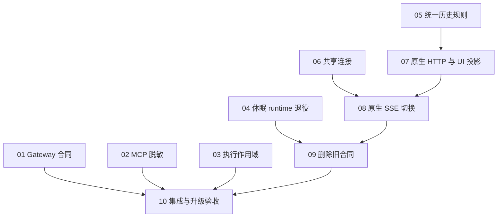

# Approved ticket graph

**Parent:** [已批准范围的规格](spec.md)
**Status:** approved — implementation authorized

用户已确认十票颗粒度与阻塞关系，并要求进入下一流程。各票已正式发布到 issues，执行 implement-spec；生产部署、重启和发行保持范围外。

## Approved tickets

| ID / Ticket | Title | Blocked by | What it delivers |
| --- | --- | --- | --- |
| [01](issues/01-gateway-wire-contracts.md) | 统一 Gateway 合同并迁移在线消费者 | 无 | 后端、Web 与 Gateway 对宿主请求和响应使用同一份数据声明；worktree、workspace、MCP 和 workbench 的现有调用继续工作。 |
| [02](issues/02-shared-mcp-secret-policy.md) | 让 MCP 导入与宿主响应共用脱敏实现 | 无 | 用户导入 MCP 配置与查看宿主结果时使用同一套脱敏纯规则，Gateway 自有错误 walker 继续承担其原职责。 |
| [03](issues/03-native-execution-scope.md) | 修正多 exec 身份并使用原生扩展包装 | 无 | 一次工具调用可执行多条命令，每条都有独立执行身份；网络重复请求仍受 Gateway ledger 抑制，扩展选择不绕过关联。 |
| [04](issues/04-retire-dormant-web-runtime.md) | 退役已被现有所有者接管的 Web runtime | 无 | Web 保持聊天、MCP 与工作台现有功能，同时移除静态休眠的本地 runtime/宿主实现及失去使用者的依赖。 |
| [05](issues/05-canonical-session-history.md) | 让 SDK 与 Web 使用同一历史规则 | 无 | SDK 与 Web 在窗口推进、已翻页历史保留、head 重置和完整替换上给出同义结果，并保留原生消息与状态字段。 |
| [06](issues/06-shared-browser-transport.md) | 让 Web 与诊断页共用连接生命周期 | 无 | Web 前台/后台订阅与 Backend 诊断页使用一份连接生命周期实现，各自认证方式继续可用。 |
| [07](issues/07-native-http-projection.md) | 迁移原生会话读取与浏览器 UI 投影 | 05 | Web 的会话、状态、上下文及扩展设置读取消费原生 Backend 载荷，由浏览器的一份投影生成现有可用 UI。 |
| [08](issues/08-native-sse-cutover.md) | 原生 SSE 端到端接入并移除 BFF 整窗折叠 | 06, 07 | Backend 的原生 delta 通过认证 BFF 到达浏览器，前后台会话继续正确呈现与结算，BFF 不再每帧展开和序列化整窗。 |
| [09](issues/09-contract-legacy-web.md) | 删除已退出的 legacy Web 合同与测试 | 04, 08 | 用户只看到当前已支持的会话能力或明确限制，维护者不再面对无生产者的事件、501 命令入口与退役 runtime 的测试。 |
| [10](issues/10-integrate-verify-consolidation.md) | 完成整合集成与升级验收 | 01, 02, 03, 09 | 六项整合在同一修订上可构建、可安装、可使用；有可追踪的浏览器升级与回滚说明，结果足以进入后续发布流程。 |

**Status:** 全部十票已解决（2026-10-15）。10 在冻结源 `c13fdd2` 与唯一生产构建 `Be4b114CesOWD7SHhEc6I`（`e20ab94`）上完成验收：18 个浏览器驱动中 16 个 exit 0，2 个为已知基线（C1、C2，既未修复也非新回归）；R6–R13 两轴各 0 剩余实质发现；完整 profile 在干净 `afc1fd0` 上 `ok: true`（118 Web tests / 57 files）；CLI 与诊断产物按闭包精确比对复用（`unchanged: true`）。无生产部署、重启或发行。

## Dependency graph

## Execution notes

- 初始 frontier 是 01–06；用户已授权开始实现。10 只列终端 blocker，全部前置工作通过传递依赖覆盖。
- 优先合入 01/02，再处理 04 可降低编辑冲突；这不是语义 blocker。03 可独立执行；05/06 可并行准备。
- manifest、exports、lockfile 等共享编辑由协调者串行整合。文件冲突不伪装为功能依赖，子任务不并发重建 graph。
- 06 是保持现有载荷可用的 expand；07 是完整 HTTP 读取路径；08 是完整 SSE/浏览器路径；09 是 contract。每票可在开发环境独立验证，07–09 一起进入同一次 Web 合同发布，不向生产发布中间状态。
- 10 复用不变源码的有效验证，补交叉合同与已有页面刷新验收。构建在 workstation/CI；生产部署、重启和发行不属于本轮规划或 ticket 的自动执行。

范围与测试边界来自用户刚批准的整合建议。用户已确认以上十票的颗粒度和阻塞关系；后续依赖变动以实际实现证据记录。
