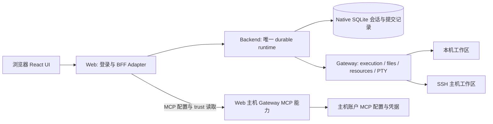

# 多路线架构、实现、设计与效能分析

分析对象：master `1758c1fb4479e9d4637a957857246c5998619d73` 加当前未提交的审计及设计修复；不是线上部署状态。六位 workers 从不同路线使用 graphify 导航，再确认源码。默认图 10,991 节点 / 21,710 边；独立 deep 图 9,855 节点 / 20,443 边。复用现有图，没有新增图提取调用；审查模型费用未独立计量。

## 架构骨架

图表达源码确认的职责和请求方向，不是 AST 最短路径推断。Web、后端和网关可以位于不同机器；MCP 的直接路径与普通执行经后端路径是刻意分开的。Web cookie 和后端 Bearer 使用不同传输/作用域，但当前登录可复用同一个 `HEPI_AUTH_TOKEN`，不能说它们天然是不同 secret。Provider 凭据属于后端：env 模式使用内存 store，Pi 模式读取后端 agentDir 的 auth.json。MCP 凭据属于主机账户。

## 六条路线

| 路线 | 报告 | 问题方向 |
| --- | --- | --- |
| 后端生命周期与持久化 | [backend](backend.md) | Native submit/dedup/watch/fork 与后端派生状态，恢复与窗口合同 |
| Web 数据流与模块设计 | [web](web.md) | BFF、acquisition、纯 projection、hook 与渲染之间的 Locality |
| Gateway/CLI 执行 | [gateway](gateway.md) | Local/SSH Adapter、装配、执行账本、关闭、PTY |
| 跨主机资源与信任 | [cross-host](cross-host.md) | workspace/gateway 身份、MCP 直接路由、凭据与 trust 归属 |
| 后端效能 | [server-perf](server-perf.md) | 增量发布、分页、搜索、资源快照、传输背压 |
| 浏览器效能与验证 | [browser-quality](browser-quality.md) | 活动 DOM、缓存、连接预算、测试与验证选择范围 |

## 已确认的设计优势

1. **持久事实只有一个 owner。** Native pi-durable 承担准入、requestId 去重、排队、结算和 fork；后端不再造幂等表。后端缓存 publication revision、projectionId、窗口及 catalogue 的派生状态，浏览器断开不会结束运行。源码入口：harness.ts:39、server.ts:780。
2. **逻辑身份隔离物理位置。** 会话绑定 workspace ID；后端选配置的 gateway，网关映射本机或 SSH root。ExecutionEnv Adapter 的 `forCall` 传入 durable call ID，执行结果可说明 completed/interrupted/outcome-unknown；这不是分布式 exactly-once 承诺。源码：gateway/environment.ts:21。
3. **生命周期 fold 是深 Module。** acquisition 为观察加身份，纯 projection 决定是否接受和要做什么，hook 执行 I/O。近期 `snapshotAccepted` 修复把旁路元数据也纳入同一接受结果，避免各调用者另写顺序判断。
4. **传输预算与原文恢复分离。** 有界窗口、delta、history token、thinking/image/text read block 共同隐藏分页、compaction 与大内容恢复知识；预览不丢原文，显式 copy/edit 恢复全文。
5. **真实变化才放 Adapter。** Local 与 SSH 共享能力义务，资源发现批成一个 host round trip；MCP 凭据不经后端，并对不属于当前 Web 主机的目录明确拒绝。

## 归并结论与优先级

核心职责划分合理：持久事实归 native durable，Web 拥有呈现，Gateway 拥有执行主机能力。应保留这些深 Module。主要改进集中在流控、调用者重复知识、两入口装配和已加载历史成本。近期四项设计审查修复见 [结果](../design-fixes/results.md)，本轮不把它们重复列作未解决问题。

| 顺序 | 项目与分类 | 证据及实际影响 | 建议 / 处置 |
| --- | --- | --- | --- |
| 1 | 终端 SSE 在途缓冲缺限额，逻辑/流控错误 | 真实 Gateway HTTP + fixture host：两条流在 3 MiB 输出下均忽略 write=false；高量 fan-in 发出 7,864,320 B 时 writableLength 达 4,007,090 B，drain 等待为 0。源码无在途界，128 KiB 仅约束 replay。未观察 OOM。 | 优先修复候选：在现有 writer Seam 统一流控，限制本地待写队列与 response 积压，明确断开/等待策略及关闭清理；不新增终端 owner。[server-perf F7](server-perf.md)、[gateway G4](gateway.md) |
| 2 | 活动历史挂载成本随加载规模增长，设计取舍 | Chromium 旧夹具：2,000 条消息 = 1,000 user turns；DOM 55,335，GC 后 heap 约 51.2 MiB，累计 long-task 时间约 25.5 s，最大任务 613 ms。不是单次交互 25 s，也不是生产延迟。 | investigate：补回到尾部后的驻留/滚动/交互观测，评估挂载窗口或按视口策略。[browser-quality](browser-quality.md) |
| 3 | 快照缓存重复全量计量，设计/实现效能 | Node 合成 ASCII、8 个近预算快照：写入+扫描约 29.8–35.9 ms；不是浏览器 trace。JSON.length 是 UTF-16 序列化长度预算，不是堆上限。 | record / 定向优化候选：维护已计量的单条长度及总量，消除重扫。新快照仍需 O(自身大小) 序列化。[web F4](web.md)、[browser-quality F2](browser-quality.md) |
| 4 | HTTP/SSE 旁证发布两份，设计 Locality 机会 | 两处已正确受 snapshotAccepted 守卫；今天没有陈旧覆盖失败。未来新增字段要同步维护两处，风险为推断。 | record：收敛 accepted facts 的发布 Seam，合并同源双表示建议；避免新增另一套时钟。[web F1/F2](web.md) |
| 5 | Gateway/CLI 两份装配产生配置差异，设计/集成 | CLI 不读取 HEPI_TERMINAL_HEARTBEAT_MS；SSH workspace 配置的拒绝行为也与 standalone 不同。触发依赖部署配置，未测实际 reconnect 影响。 | record：共享构造与生命周期，两个入口保留各自配置读取；已有两个真实调用方，不需猜未来 Adapter。[gateway G1](gateway.md) |
| 6 | 信任按钮 POST 未实现，既有能力缺口 + UI 残留 | 实际路由 GET 才进主机 trust reader；POST 落 durableApi 501。只读+主机 CLI 记录信任是当前合同。 | record：让控件和说明如实表达当前合同；不是新安全故障，不新增 Web trust writer。[cross-host F1](cross-host.md) |

以下保持记录：全会话 attachment 生命周期的内存增长尚未测；读帧类型三份声明当前一致，属于合同维护成本；legacy /busy 墓碑检查不一致但当前 Web 不调用；能力探测网络异常的保守假阴性；缓存注释和 dormant 上游 helper 的漂移。它们不自动进入新实现循环。

Gateway 的 capture 复制算法在小块合成负载下有数秒累计 CPU 成本，但该探针没有调用真实 Gateway execute；实际输出块分布和端到端停顿未测。同步 journal begin/complete 的毫秒写盘成本已测，但 prune 不是已证瓶颈。两者先 record，再以真实使用触发重访。

## 效能证据：哪些已经测到

| 路径 | 数值 | 口径 / 限制 |
| --- | --- | --- |
| 增量窗口推进 | 追加 3 条约 0.004 ms，总历史 2k–200k 基本不变 | 本轮纯函数 Node 夹具；不是完整 publish、HTTP 或 durable commit 墙钟 |
| catalogue 追加身份扫描 | 2k/20k/200k：0.008/0.081/0.849 ms | 本轮 Node 微基准；O(N) 存在但此夹具下影响低 |
| 历史 delta 传输 | 10–240 turns：约 721–726 B/turn，最大帧约 1.04 KiB | 复用合成 faux-provider 基准；无真实图片/工具流量 |
| 活动 DOM/heap | 2,000 messages：55,335 DOM 节点、约 51.2 MiB post-GC heap | 复用本地 Chromium 基准；分页耗时包含约 450 ms settle 轮询，不能当纯 render latency |
| 缓存写入和计量 | 近 32 MiB 名义序列化长度的合成载荷：约 30–36 ms | 本轮 Node；不与 Chromium long-task 做 CPU 归因比较 |
| 终端 SSE | 高量 fan-in：约 7.5 MiB 输出 → 约 3.82 MiB 服务端待写，drain=0 | 本轮真实 HTTP writer + host double，客户端不读；输出封顶 8 MiB、10 s 截止，未测试 OOM/真实 SSH |

搜索机制已纠正：deadline 在页内每条条目前也检查；不能抢占的是单次原生 entries() 读取。先前“仅页边界检查”的文字错误已改在 [历史性能研究](../development-audit/performance-research.md)。搜索 500 会话/30 结果/3 s 是具名合作式预算，不是强实时承诺。

具体解法、替代方案与可删逻辑见 [让解法减少状态与分支](solutions.md)。后续获授权的实施见 [统一设计 spec](../architecture-unification/spec.md) 与 [tickets](../architecture-unification/ticket-breakdown.md)；本报告仍保留原分析范围。

## 如何推进设计

优先修复已经有运行时证据的终端流控。terminal listener/emit 是 void；仅让 writer 等待 drain 会把积压搬到本地 queue，须同时约束该 queue 或按 reconnect/replay 合同断开慢消费者。其后按用户规模验证活动历史与缓存，使用真实调用分布验证 capture；普通追加投影与 catalogue 微秒成本暂不扩展成索引或调度重写。旁证、wire 类型和 gateway 装配可作为小范围 Locality 整理，必须保持已有真实 Interface 行为和测试 Seam。只读 trust 的按钮属于能力呈现整理。

本轮做的是分析与证据归并，没有执行上述实现建议。

## 证据与方法限制

Graph `_origin`（AST/semantic）与 confidence（EXTRACTED/INFERRED）是两轴；图里的社区名不是架构合同。AST 不捕捉全部 HTTP/SSE 动态派发；没有 createBackendServer → GatewayRpcServer 有向路径不能证明实现缺失。中文概念映射到图中实际词汇：harness、conversation、submission、lifecycle、projection、gateway、worktree、history、catalogue、snapshot、trust、cache，再用准确符号缩小查询。截断结果不能用来断言没有功能或调用者。

归并时回源与读最终日志纠正了初稿误判：dormant Web trust helper 不是第二个活动 owner；provider 的内存 store 仅限 env 模式；GET reader 的 405 不是浏览器 POST 的真实返回；graph built_at_commit 不是脏工作树快照；被覆盖运行的终端数值不进入证据；复制 capture 算法的成本不等于真实 HTTP 卡顿。每项数值只引用其实际保存的运行，源码复杂度和候选改法不冒充实测。

本轮只写报告与探测产物，产品源码只读。既有检查按未变源码复用：workspace types/tests 通过，Web 2307 pass / 16 既有 fail，浏览器 deferred text17/history11/Settings23 通过；这不是本轮重新运行所有套件。新测量命令、exit、源码与日志各报告单列；旧性能证据仍绑定原夹具与被测修订。工作范围见 [scope](scope.md)。
