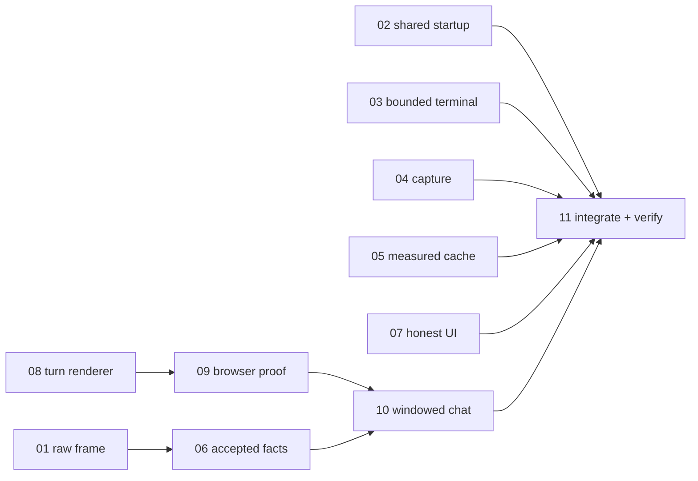

# Ticket breakdown

[Spec](spec.md) · [决策](decisions.md) · [实施导航](navigation.md) · [审查](review.md) · [非阻塞记录](review-notes.md)

Status: implementation and functional acceptance complete (2026-10-15). The work was delivered from an uncommitted
`integration/architecture-unification` working tree and has since been superseded in place by later lines — the
`.dev/verify` logs its tickets cite were local and are not tracked. Ticket files are authoritative for what each ticket
measured; [11](issues/11-integrate-verify.md) holds the cross-ticket record. Current behavior: [Chat](../../docs/chat.md).

| 票 | 切片 | Blocked by | 当前状态 |
| --- | --- | --- | --- |
| [01](issues/01-shared-projection-contract.md) | 公共投影帧贯通生产消费者 | None | done |
| [02](issues/02-gateway-composition.md) | CLI 与 standalone 统一 Gateway 装配 | None | done；installed Local/SSH smoke6/6 |
| [03](issues/03-bounded-terminal-delivery.md) | 慢终端消费者有界断开与恢复 | None | done |
| [04](issues/04-linear-output-capture.md) | execution 捕获线性累积 | None | done |
| [05](issues/05-measured-session-cache.md) | 会话切换缓存统一计量记账 | None | done |
| [06](issues/06-accepted-snapshot-owner.md) | HTTP/SSE 共用已接受事实拥有者 | 01 | done |
| [07](issues/07-honest-capability-ui.md) | Settings 与 MCP trust 如实呈现能力 | None | done；unit/browser覆盖 |
| [08](issues/08-transcript-turn-model.md) | 完整 turn 描述与单一 renderer | None | done |
| [09](issues/09-dynamic-window-proof.md) | 动态高度窗口选择与 browser证明 | 08 | done；平台方案选定，性能测量限制已记录 |
| [10](issues/10-bounded-transcript-window.md) | 生产窗口挂载与导航 | 06, 09 | done；最终 production48 checks + prefix/reconnect11 checks |
| [11](issues/11-integrate-verify.md) | 整合、验证与旧路径收缩 | 02, 03, 04, 05, 07, 10 | done |

九方案映射：wire→01；Gateway→02；terminal→03；capture→04；cache→05；beside-state→06；read-only trust与capability UI→07；turn history→08/09/10。11核对组合行为、被替代路径与证据。依赖表示真实输入/Interface；排程冲突不是 blocker。
