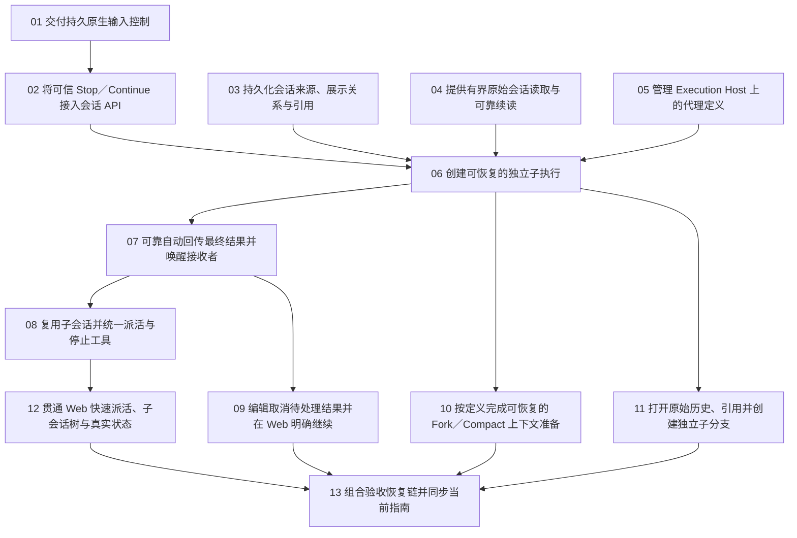

# Durable subagents — 实施入口与票据图

Status: accepted (all 13 tickets; combined acceptance green 2026-10-17)
Labels: done
Date: 2026-10-16

[正式 spec](spec.md) 是产品范围、行为与验收的权威来源。以下13张本地票据按依赖编号，已经发布，用户已批准开始实作。原始研究保留为证据，不覆盖本规格；本轮不部署、不重启生产服务。

## 已有基础与执行边界

M0 的 pi-durable/chord/pi-ai 1.3.0 升级、queue-only admission 和基础探针已有工作区成果，见[原始验证记录](../webui-next-exploration/durable-upgrade-results.md)。不要重复开升级票，不把该证据当作完整产品验收，也不要覆盖这些未提交改动。

模型入口固定为 agent_spawn/send/stop/get/read，conversation_* 仅底层 API。上下文策略由定义/用户配置决定，主 agent 只选代理和传任务。正常完成可复用 child，框架自动回报并唤醒正常空闲接收者；用户停止后模型不能恢复，迟到结果保持 held；主 stop 不取消 child。

用户已明确批准实现整份规格。集成分支为 integration/durable-subagents；各 worker 使用独立 worktree。当前分工与实际证据见[实施台账](implementation.md)。领取 frontier 票据先改为 claimed；完成验收并记录证据后改为 resolved，按依赖继续推进；不包含生产变更。

## 票据与阻塞项

13/13 全部验收。01／02／03／04／05／06／07／10／11已合入集成分支并验收（07 `565c634`；10 `72d5ce9` server 406/406；11 `649bce4` web 96/96 + browser 40/40）。08／09／12已验收（08 `cbb54aa`；09 `9672a36`；12 `fb04eb7`）。13 在 `impl/durable-subagents-13`（base `b6b6745`）完成组合验收：[A01–A22 映射](issues/13-system-acceptance.md#acceptance-mapping-a01a22)，五个 driver 8/8，生产 browser 旅程 53/53，`pnpm verify:changed` exit 0；review 六项已按[review policy](../../docs/agents/review-policy.md)处置（两处 fix、四处 record，见该票 Review disposition）。coordinator 已在 `1062840` 合入集成分支并随 2026-10-17T10:54Z 常规部署上线；该部署只是部署检查，acceptance driver 未对 live 栈运行。编号只约束依赖顺序，非全串行排期。

| Ticket | Blocked by | 独立可验证交付 |
| --- | --- | --- |
| [01 — 交付持久原生输入控制](issues/01-native-input-control.md) | None | 通过公开 runtime API 停止一个会话后，所有输入保持排队，直到获准继续；同一 SQLite 重开仍保持该意图。此票是明确的原生前置交付，可由受控 harness 演示，不包含 Web 或产品 HTTP 编排。 |
| [02 — 将可信 Stop／Continue 接入会话 API](issues/02-conversation-stop-continue.md) | 01 | 用户通过既有会话 HTTP 控制停止、查询并继续同一会话；停止来源、当前状态与操作收据可重取，网络丢答复不会撤销已提交意图。 |
| [03 — 持久化会话来源、展示关系与引用](issues/03-conversation-relations.md) | None | 用户或宿主创建独立主会话和显式 child，并通过统一查询区分谁创建、展示在哪、从哪里 fork；另一已授权会话可引用目标而不改变其归属。 |
| [04 — 提供有界原始会话读取与可靠续读](issues/04-bounded-conversation-read.md) | None | 调用方通过核心 read/HTTP 读取真实会话原始历史、指定 entry/block 和图片；即使历史很长、单行超限或读取期间有新消息，仍能有界、可靠地继续。 |
| [05 — 管理 Execution Host 上的代理定义](issues/05-agent-definitions.md) | None | 用户在 Settings 选择真实本地/SSH Execution Host，以表单或原文创建、验证、保存和删除 project/user Agent Definition；读取和写入始终发生在该主机。 |
| [06 — 创建可恢复的独立子执行](issues/06-durable-child-execution.md) | 02、03、04、05 | 主 agent 选择定义并提供任务，框架创建持久 child、保存派活身份、提交初始工作并先返回 ID；主会话继续工作，用户能打开 child，并通过 get/read 获取真实状态和结果。 |
| [07 — 可靠自动回传最终结果并唤醒接收者](issues/07-automatic-result-delivery.md) | 06 | child 直接给出最终答复后，框架无需 contact、轮询或额外总结回合，自动将结果交给登记接收者；正常空闲会话继续处理，用户停止的会话仅看到待处理项。 |
| [08 — 复用子会话并统一派活与停止工具](issues/08-reusable-agent-control.md) | 07 | 主 agent 或另一已授权会话向正常完成的同一 child 继续派活，结果返回本次发起方；模型可以停止工作，但无法覆盖用户停止。最终模型工具集完整为五个 agent_*。 |
| [09 — 编辑取消待处理结果并在 Web 明确继续](issues/09-pending-item-controls.md) | 07 | 用户停止主会话后，Web 显示迟到报告；用户逐项编辑/取消，再明确 Continue，模型只处理最终保留的正文。 |
| [10 — 按定义完成可恢复的 Fork／Compact 上下文准备](issues/10-configured-context-preparation.md) | 06 | 用户配置的上下文策略通过真实 spawn 创建流程生效；框架固定来源、完成准备并提交结果后才派活，主 agent 无法改变策略。 |
| [11 — 打开原始历史、引用并创建独立子分支](issues/11-child-forks-history-references.md) | 06 | 用户在 Web 查看 compact 前原始历史和会话引用，从 child 指定 entry fork 新分支；原父已隐藏时，新分支仍保持正确身份和可读继承内容。 |
| [12 — 贯通 Web 快速派活、子会话树与真实状态](issues/12-web-agent-workflows.md) | 08 | 用户无需编写模型提示，在主会话快速选择或创建代理并派活，能从子会话树打开同一完整 ChatWindow、继续工作并查看真实执行/限制状态。 |
| [13 — 组合验收恢复链并同步当前指南](issues/13-system-acceptance.md) | 09、10、11、12 | 用户获得经真实多会话、真实进程中断和浏览器旅程验证的完整 subagents 功能；当前指南清楚区分已交付行为、配置方式及剩余限制。（resolved） |

## 依赖图

01是单独可发布/验证的原生API前置契约；02在其上接产品HTTP控制。06先证明真实child身份与执行，07补完整自动回报闭环；不能在06结束时宣称完整subagents交付。10依赖06以验证真实spawn的准备/提交交接，而不只交付独立helper；无需等待reporter/UI，可与07、11并行。11确实需要真实child anchor；12不依赖09，因为队列编辑由09独立交付，最后在13组合。只记录直接阻塞边，不重复罗列传递祖先。

## Completion criteria

- 实现只覆盖当前票据的用户可观察行为；优先现有模块/原生接缝，不建第二套runtime、held队列或代理状态库。模块和URL细节由owning ticket选择并记录，不任意扩spec。
- 每票有明确公开验证接缝。原生补丁以公开runtime API验证，产品行为经HTTP/模型工具和实际SQLite验证，Web票据追加真实浏览器旅程；测试原子性所需原生边界，不重复铺满每层。
- 各票同步其owning当前指南，并保留测试命令、所测revision/dirty状态、实际退出码、原始日志与已知限制；13只组合复核，不替先行票补全部测试或文档。
- 相关选择检查优先 pnpm verify:changed；原生/HTTP/浏览器/crash checks按行为添加。每次运行独占端口、SQLite、构建目录与产物，不写其他测试的默认tracked输出。
- 真SIGKILL与完整交接矩阵是恢复声明的条件；页面reload、正常close、listener单测或旧M0探针不能替代。unsafe工具不盲重放，不承诺外部副作用exactly-once。
- 材料性问题按[review policy](../../docs/agents/review-policy.md)在责任边界修复；其余记录实际触发、影响、处置和重访条件，不自动开新阻塞循环。
- 领取前核对当前源与相关任务状态，不覆盖已有未提交工作；完成不包含生产部署。仅工作站/CI构建，remote-host只运行预构建产物。

## 验收覆盖

每项定义见[spec验收表](spec.md#testing-decisions)。下表列实施责任，13复用已有证据并组合验收全部A01–A22。原生边界与API/browser断言各有作用，不能只看DOM或只看内部字段。

| Spec验收 | 先行交付票据 | 最终门禁 |
| --- | --- | --- |
| A01 | [12 — 贯通 Web 快速派活、子会话树与真实状态](issues/12-web-agent-workflows.md) | 13 组合复核 |
| A02 | [03 — 持久化会话来源、展示关系与引用](issues/03-conversation-relations.md)、[06 — 创建可恢复的独立子执行](issues/06-durable-child-execution.md)、[08 — 复用子会话并统一派活与停止工具](issues/08-reusable-agent-control.md)、[11 — 打开原始历史、引用并创建独立子分支](issues/11-child-forks-history-references.md) | 13 组合复核 |
| A03 | [06 — 创建可恢复的独立子执行](issues/06-durable-child-execution.md)、[08 — 复用子会话并统一派活与停止工具](issues/08-reusable-agent-control.md)、[12 — 贯通 Web 快速派活、子会话树与真实状态](issues/12-web-agent-workflows.md) | 13 组合复核 |
| A04 | [07 — 可靠自动回传最终结果并唤醒接收者](issues/07-automatic-result-delivery.md) | 13 组合复核 |
| A05 | [08 — 复用子会话并统一派活与停止工具](issues/08-reusable-agent-control.md) | 13 组合复核 |
| A06 | [07 — 可靠自动回传最终结果并唤醒接收者](issues/07-automatic-result-delivery.md)、[08 — 复用子会话并统一派活与停止工具](issues/08-reusable-agent-control.md) | 13 组合复核 |
| A07 | [07 — 可靠自动回传最终结果并唤醒接收者](issues/07-automatic-result-delivery.md)、[09 — 编辑取消待处理结果并在 Web 明确继续](issues/09-pending-item-controls.md) | 13 组合复核 |
| A08 | [01 — 交付持久原生输入控制](issues/01-native-input-control.md)、[02 — 将可信 Stop／Continue 接入会话 API](issues/02-conversation-stop-continue.md)、[09 — 编辑取消待处理结果并在 Web 明确继续](issues/09-pending-item-controls.md) | 13 组合复核 |
| A09 | [01 — 交付持久原生输入控制](issues/01-native-input-control.md)、[02 — 将可信 Stop／Continue 接入会话 API](issues/02-conversation-stop-continue.md)、[08 — 复用子会话并统一派活与停止工具](issues/08-reusable-agent-control.md) | 13 组合复核 |
| A10 | [01 — 交付持久原生输入控制](issues/01-native-input-control.md)、[02 — 将可信 Stop／Continue 接入会话 API](issues/02-conversation-stop-continue.md)、[09 — 编辑取消待处理结果并在 Web 明确继续](issues/09-pending-item-controls.md) | 13 组合复核 |
| A11 | [09 — 编辑取消待处理结果并在 Web 明确继续](issues/09-pending-item-controls.md) | 13 组合复核 |
| A12 | [05 — 管理 Execution Host 上的代理定义](issues/05-agent-definitions.md)、[12 — 贯通 Web 快速派活、子会话树与真实状态](issues/12-web-agent-workflows.md) | 13 组合复核 |
| A13 | [05 — 管理 Execution Host 上的代理定义](issues/05-agent-definitions.md)、[06 — 创建可恢复的独立子执行](issues/06-durable-child-execution.md)、[10 — 按定义完成可恢复的 Fork／Compact 上下文准备](issues/10-configured-context-preparation.md) | 13 组合复核 |
| A14 | [10 — 按定义完成可恢复的 Fork／Compact 上下文准备](issues/10-configured-context-preparation.md) | 13 组合复核 |
| A15 | [05 — 管理 Execution Host 上的代理定义](issues/05-agent-definitions.md)、[06 — 创建可恢复的独立子执行](issues/06-durable-child-execution.md)、[12 — 贯通 Web 快速派活、子会话树与真实状态](issues/12-web-agent-workflows.md) | 13 组合复核 |
| A16 | [04 — 提供有界原始会话读取与可靠续读](issues/04-bounded-conversation-read.md)、[06 — 创建可恢复的独立子执行](issues/06-durable-child-execution.md)、[11 — 打开原始历史、引用并创建独立子分支](issues/11-child-forks-history-references.md) | 13 组合复核 |
| A17 | [04 — 提供有界原始会话读取与可靠续读](issues/04-bounded-conversation-read.md)、[11 — 打开原始历史、引用并创建独立子分支](issues/11-child-forks-history-references.md) | 13 组合复核 |
| A18 | [09 — 编辑取消待处理结果并在 Web 明确继续](issues/09-pending-item-controls.md)、[11 — 打开原始历史、引用并创建独立子分支](issues/11-child-forks-history-references.md)、[12 — 贯通 Web 快速派活、子会话树与真实状态](issues/12-web-agent-workflows.md) | 13 组合复核 |
| A19 | [06 — 创建可恢复的独立子执行](issues/06-durable-child-execution.md)、[07 — 可靠自动回传最终结果并唤醒接收者](issues/07-automatic-result-delivery.md)、[10 — 按定义完成可恢复的 Fork／Compact 上下文准备](issues/10-configured-context-preparation.md) | 13 组合复核 |
| A20 | [01 — 交付持久原生输入控制](issues/01-native-input-control.md)、[02 — 将可信 Stop／Continue 接入会话 API](issues/02-conversation-stop-continue.md)、[09 — 编辑取消待处理结果并在 Web 明确继续](issues/09-pending-item-controls.md) | 13 组合复核 |
| A21 | [01 — 交付持久原生输入控制](issues/01-native-input-control.md) | 13 组合复核 |
| A22 | [02 — 将可信 Stop／Continue 接入会话 API](issues/02-conversation-stop-continue.md)、[03 — 持久化会话来源、展示关系与引用](issues/03-conversation-relations.md)、[07 — 可靠自动回传最终结果并唤醒接收者](issues/07-automatic-result-delivery.md)、[11 — 打开原始历史、引用并创建独立子分支](issues/11-child-forks-history-references.md) | 13 组合复核 |

## 恢复检查窗口

13在隔离backend进程、测试独占SQLite和受控模型/工具上，覆盖创建提交→spawn答复、admission→receipt、完整终态→投送、结果queued→reporter确认、编辑/取消提交后、stop提交→普通范围drain、continue提交→HTTP答复、较新stop→旧continue重试，以及用户停止后重开/模型恢复拒绝。逐窗记录收据、投影、模型请求和副作用计数。具体完成语义由spec D04–D09/D16及A19–A21约束。

窗口与 driver 的对应（2026-10-17，`impl/durable-subagents-13`，base `b6b6745`）：

| 窗口 | driver |
| --- | --- |
| 创建提交→spawn答复、admission→receipt、完整终态→投送、回报入队→确认（同一条链两次真实 SIGKILL） | `apps/server/test/acceptance-chain.test.ts` |
| stop 已提交但普通范围仍在 drain | `apps/server/test/acceptance-recovery.test.ts`（`stop-drain`） |
| continue 已提交、HTTP 答复未被读到 | 同上（`continue-answer`） |
| 较新 stop 之后旧 continue 重试 | 同上（`newer-stop-old-continue`） |
| 编辑/取消之后真实 SIGKILL | `apps/server/test/pending-item-controls.test.ts`（`a real SIGKILL after an edit and a cancel…`） |
| unsafe 工具在 execute 内被杀、不盲重放 | `apps/server/test/acceptance-failure.test.ts` |
| 任务定义缺失 → `missing_task` | 同上 |
| 多会话关系与 Retained Binding 继承 | `apps/server/test/acceptance-multisession.test.ts` |
| 合并输入共享 answer 引用 | `apps/server/test/acceptance-shared-answer.test.ts` |
| 用户可见全链路（生产构建浏览器旅程） | `apps/web/e2e/ux-system-acceptance.mjs` |

命令、退出码与原始日志见 [13 的实施记录](issues/13-system-acceptance.md#verification-2026-10-17-this-branch)与[验证指南](../../docs/verification.md#durable-subagents-the-combined-acceptance-gate-2026-10-17)。当前状态与最终证据见[实施台账](implementation.md)顶部 Status 与文末 Closed 段。

## 决策与证据

- 已确认方案：[设计研究入口](../webui-next-exploration/conversation-api-proposal.md)。
- 恢复证据要求：[原始恢复矩阵](../webui-next-exploration/durable-recovery.md)。
- 实施前需要了解的确定性边界：[共享答案、Stop drain、Read续读与压缩风险](../webui-next-exploration/design-risk-review.md)。
- 验证报告要求：[verification practice](../../docs/agents/verification.md)。

原规格发布阶段只执行过文档、链接、依赖图与覆盖检查；实际产品测试证据随各实施票据和最终13记录，不能混用。
