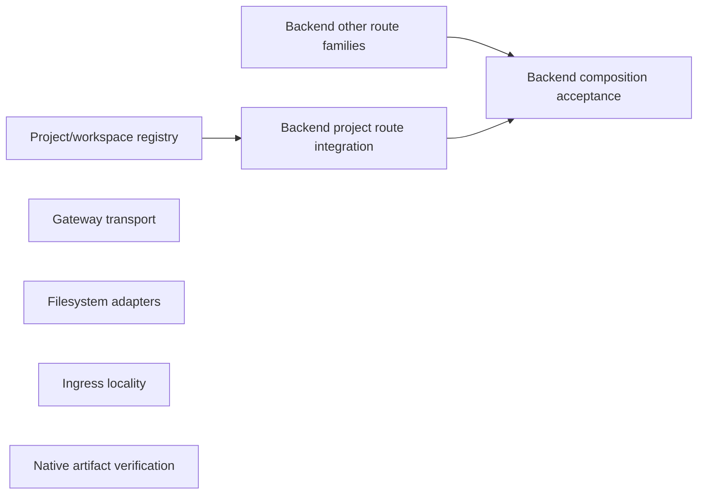

# Non-UI architecture design

Status: six approved specs; implementation active alongside UI architecture refactor. Requested 2026-10-21; source baseline `5ec7ffe6`. This effort turns the [dated audit](../non-ui-architecture-audit/report.md) into separate implementation plans. [Shared requirements](requirements.md) apply to every spec. No data migration or deployment is included. Ticket status follows each spec area’s `ticket-plan.md`.

## Specs and recommended designs

| Effort | Spec | Chosen module / seam | What callers stop knowing |
| --- | --- | --- | --- |
| Backend composition | [Spec](../backend-composition/spec.md) | Existing BackendServer; concrete domain HTTP modules and internal attachment owner | Unrelated route rules, attachment setup/disposal details |
| Project/workspace registry | [Spec](../workspace-registry/spec.md) | Backend registry over current store and Gateway host clients | Array surgery, publication order, retained resolution/registration glue |
| Gateway transport | [Spec](../gateway-transport/spec.md) | One listener, concrete transport families | Other protocols’ framing, cursors, cancellation and body limits |
| Filesystem adapters | [Spec](../filesystem-adapters/spec.md) | Existing FilesystemServer; readable statically bundled helper | Embedded one-line program layout and obsolete constructor aliases |
| Ingress locality | [Spec](../ingress-binding/spec.md) | Existing callback, one Backend-owned locality verdict | Workspace/host list joins and profile-list interpretation |
| Native artifact verification | [Spec](../native-artifact-verification/spec.md) | Concrete verification operation and private environment lifetime | Display/credential/process acquisition and teardown order in assertions |

Depth means fewer caller facts and better locality, not a LOC ratio or arbitrary method count. Every spec compares alternatives, names removals, classifies dependencies and maps acceptance to actual interface observations. Proposed names are illustrative, current paths are source evidence.

## Exploration coverage

| Areas | Minimal interface | Common caller / workflow | Ownership / adapters |
| --- | --- | --- | --- |
| Backend composition + workspace registry | agent-237 | agent-238 | agent-239 |
| Gateway transport + filesystem adapters | agent-240 | agent-241 | agent-242 |
| Ingress binding + native verification | agent-243 | agent-244 | agent-245 |

Three independent scout perspectives per area, nine scouts total. Parent source-confirmed the recommended designs and rejected unsupported claims: a parameter object alone does not deepen a module; deleting remote path validation is not a simplification; moving Python to a file needs source-run and artifact accounting; a new ingress router does not answer topology ownership. [Design comparisons and review notes](review-notes.md) retain dispositions.

Independent reviewers: agent-246 covers behavior/ownership/source accuracy; agent-247 covers depth/locality/lightness. Each reviews all six specs. Agent-247 completed with two actionable contract-clarity findings, fixed in registry checkout workflow and retained workspace membership; no material issue in other four specs. Agent-246 found two registry contract gaps, now fixed: no-store configured bindings and checkout `projectsRevision`; no material findings in other specs.

## Dependencies and parallel work

Only the arrow from registry to Backend project routes is a cross-effort implementation prerequisite. Diagram’s other arrows are internal Backend integration. Gateway, filesystem, ingress and native designs can proceed independently; Backend’s other route-family preparation need not wait for registry implementation.

| Shared edits | Integration rule |
| --- | --- |
| server.ts registry/project routes vs Backend extraction | Registry owner settles domain interface first; route extraction consumes it. One integration owner applies overlapping closure edits. |
| server.ts workspace endpoint vs ingress verdict | Ingress owner provides complete predicate/wire patch; integrate with workspace HTTP owner once. No duplicate parallel endpoint. |
| Gateway index FilesystemServer / LocalFilesystem imports | Filesystem owner supplies alias migration; transport owner consumes it. Protocol extraction does not wait for Python source representation. |
| Native verification vs UI artifact acceptance | Reuse only the unchanged, real packaged artifact workflow; native cleanup is not a prerequisite for current UI delivery. |

Recommended first integration: registry, then Backend project routes. Other areas may be prepared and verified in isolated worktrees without a forced six-item serial chain. Implementation tickets now encode these dependencies; preparation remains parallel where no contract dependency exists.

## Combined UI + non-UI implementation frontier

This graph joins the active [UI architecture refactor](../ui-architecture-refactor/ticket-plan.md) to all six non-UI implementation plans above. Keep every effort's ticket as its authoritative unit; this section supplies cross-effort edges and safe merge windows. Every implementer uses a separate worktree based on `impl/ui-architecture-refactor`, reads `implement-spec`, owns only the ticket's listed paths, and merges the latest integration tip before reporting. Merger integrates one patch at a time; recalculate readiness after each merge. No ticket is complete by plan alone.

### First wave — integrated

Started from source baseline `5ec7ffe6` on 2026-10-21. Gateway Transport 01, Filesystem Adapters 01 and Native
Verification 01 integrated at `631c954e`; Workspace Registry 01 integrated at `e3c278c0`; corrected UI 03 integrated
at `9828ff0d`. Filesystem Adapters 02 then integrated at `ce8aa223`, completing that effort. Reuse the ticket-specific
verification evidence. New worktrees start from `impl/architecture-consolidation`.

Second wave integrated: Workspace Registry 02/03 and Gateway Transport 02 merged; UI04/05/08 integrated at `b3ab7871` with combined changed checks and focused browser journeys passing. Backend Composition01 (`899cb45`) and Gateway Transport03 (`d24eac04`) integrated/reviewed; UI06 correction (`8a64b0e2`) integrated at `07943df4`, final evidence `e6a0ffd2`. Backend Composition02 integrated and reviewed with no material findings at `301c52f4`; changed typecheck, full server tests and docs check pass. UI11 Shell composition remains in progress (agent-285). UI12 acceptance preparation is read-only; Ingress01 is in progress on `impl/nonui-ingress-01`. Native Verification 02 integrated at `8a44daa9` with
54/54 real packaged checks, App typecheck, 29 tests and docs checks passing. Missing-artifact CLI failure also confirms
teardown before returning failed report. See its ticket for revision, artifact hash, logs and review limitation.
Filesystem no longer blocks Gateway 02.

- **UI03 correction** — resolved and integrated at `9828ff0d`; subsequent lifetime seam checks passed with UI04/08. Non-UI workers keep UI source untouched.
- **Workspace Registry 01** — owns Backend `server.ts` resolution/registration extraction.
- **Gateway Transport 01** — owns Gateway dispatch extraction without Filesystem alias/callsite migration.
- **Filesystem Adapters 01** — owns readable SSH helper/build-time inlining only.
- **Native Artifact Verification 01** — isolated App verification CLI seam.

These paths do not overlap. This releases non-UI work immediately while UI 03 is repaired; UI is not a gate for non-UI implementation.

### Subsequent readiness

1. **Workspace Registry 02 then 03**: exclusive owner of project/worktree mutations in `apps/server/src/server.ts`; keep Backend Composition and Ingress endpoint work off that file until registry has finished its route edits.
2. **Backend Composition 01** starts after Registry 02 and 03, extracting attachment lifetime; **Backend Composition 02** follows 01 and owns concrete handlers. Registry server edits must be merged first. Backend 02 establishes workspace route module seam for ingress.
3. **Filesystem Adapters 02** follows Gateway 01; owns `FilesystemServer` alias/import/callsite migration including shared `packages/gateway/src/index.ts` lines. Gateway Transport 02 follows both Gateway 01 and Filesystem 02; Gateway Transport 03 follows Gateway 02 and Filesystem 02.
4. **Ingress Binding 01** follows Backend Composition 02 and Workspace Registry 01; adds Backend verdict to already extracted workspace handler. **Ingress Binding 02** follows verdict; owns `packages/gateway/src/ingress/index.ts` migration.
5. **Backend Composition 03** follows Backend Composition 02, Workspace Registry 02, and Ingress Binding 01; final composition owns `server.ts` integration after these writers merge.
6. **Native Artifact Verification 02** follows Native 01 only; can proceed in any wave on workstation/CI against prebuilt artifact.
7. UI 04/05/08 follow corrected UI 03; UI 06 follows UI 03+05; UI 11 follows all UI 01–10; UI 12 follows UI 11. Keep UI-specific owners serialized by their documented shared paths; do not make UI 04–10 wait for non-UI work absent an interface dependency.

### Shared-path guardrails

`apps/server/src/server.ts`: one active writer at a time, ordered Registry 01 → Registry 02 → Registry 03 → Backend 01 → Backend 02 → Ingress 01 → Backend 03; if a ticket's scoped change avoids this file, only then may it overlap after confirming no shared generated interface. `packages/gateway/src/index.ts`: Gateway 01 → Filesystem 02 → Gateway 02 → Gateway 03. `packages/gateway/src/ingress/index.ts`: Ingress 02 only. `packages/ui/**`: keep current UI ticket owners and scopes; non-UI workers do not edit them. Native artifact verification consumes a named prebuilt App artifact; it does not build on remote-host.

## Implementation frontier and shared-file ownership

Follow each ticket's `Blocked by` edges as a DAG; each implementer uses its own worktree/branch based on the integration branch, merges the latest integration tip before reporting, and a merger integrates completed work before releasing newly unblocked tickets. Do not start blocked tickets speculatively. Parallel branches touching the same file are not safe merely because Git worktrees are separate.

| Wave | Safe parallel tickets | Why |
| --- | --- | --- |
| 1 | Workspace Registry 01; Gateway Transport 01; Filesystem Adapters 01; Native Verification 01 | Distinct paths; each owns an isolated starting seam. |
| 2 | Workspace Registry 02; Filesystem Adapters 02; Native Verification 02 | Registry owns project routes; filesystem owns alias/callsite migration after Gateway 01; native remains isolated. |
| 3 | Workspace Registry 03; Gateway Transport 02 | Checkout edits remain in registry; Gateway waits for filesystem callsites. |
| 4 | Backend Composition 01; Gateway Transport 03 | Backend waits for all registry `server.ts` route edits; Gateway finishes after adapter migration. |
| 5 | Backend Composition 02 | Exclusive owner of remaining Backend handler extraction. |
| 6 | Ingress Binding 01 | Adds locality endpoint only after workspace handler extraction is merged. |
| 7 | Backend Composition 03; Ingress Binding 02 | Backend composition and Gateway ingress client are separate paths; both consume merged locality contract. |

Native Verification 02 is unblocked after Wave 1 and may run in any later wave. These are safe waves, not extra dependencies; recalculate frontier after each merge.

The exact graph is in each ticket plan. These waves are conservative safe-frontier guidance; after every merge, recalculate ready tickets from blockers rather than treating wave numbers as additional dependencies. `apps/server/src/server.ts` is the highest-conflict path: only one active implementer may edit it at a time. Gateway/Filesystem share `packages/gateway/src/index.ts` callsites: Gateway Transport 01 precedes Filesystem Adapters 02, which precedes Gateway Transport 02/03. `packages/gateway/src/ingress/index.ts` belongs only to Ingress Binding 02. Native artifact work stays separate and consumes prebuilt artifacts.

## Evidence and status

[Source navigation](navigation.md) records narrow graph queries and their truncation limits. [Scout brief](brief.md) records common constraints. [Review notes](review-notes.md) records design findings and dispositions. Each ticket owns its current status and implementation evidence. Current operating guides own delivered behavior.
