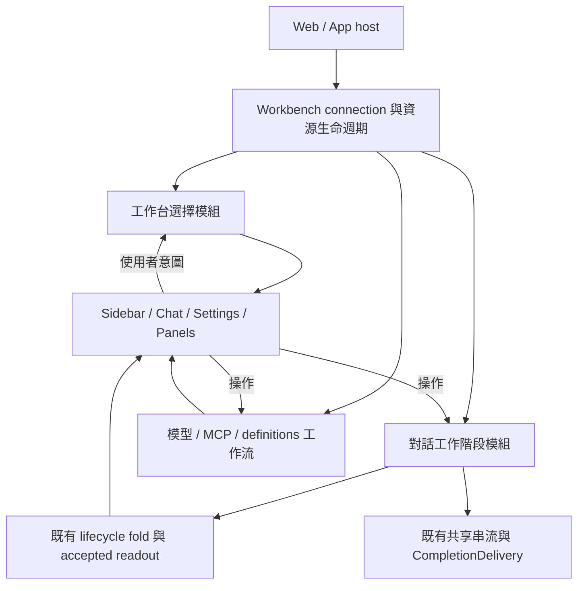

# UI 架構收斂規格

Type: spec
Status: in-progress — 使用者已同意規格並授權 workers 實作；依票單順序整合及驗收。
Date: 2026-10-21
Baseline: a57100bb4917d408ee51c19beeda30d3efecc857
Request: 使用者先要求記錄盤點與完整規格／tickets，隨後同意並明確要求使用 workers 實作。部署與重啟仍不在範圍。

## 入口與權威

- 現況證據：[功能與架構盤點](../ui-architecture-audit/report.md)、[靜態統計](../ui-architecture-audit/metrics.json)。它們記錄基準版本，不是故障重現或效能報告。
- 執行順序、狀態、檔案責任與依賴：[票單計畫](ticket-plan.md)。每票是可整合的完整替換切片。
- 必須保留的使用者行為及驗證歸屬：[行為與驗收矩陣](acceptance.md)。矩陣定義驗收要求，並不表示已執行。
- 非阻擋限制及待觀察事項：[評估記錄](review-notes.md)。
- 已交付產品契約以[架構](../../docs/architecture.md)、[聊天](../../docs/chat.md)、[工作台](../../docs/workbench.md)及[開發指南](../../docs/developer-guide.md)為準；實作若發現衝突，先記錄具體差異並修正本規格，不默默改變使用者行為。

## 問題與目標

AppShell、SessionSidebar、ChatWindow 與 useAgentSession 共同協調工作台選擇、對話初始化、歷史與捲動。呼叫端需知道回呼先後、重掛計數器、可變 ref 以及 refreshKey。設定畫面還直接協調資源讀寫、取消及刷新，測試因此出現截取元件原始碼再放進 VM 的做法。

本工作讓一次轉換、一個資料接受決策、一種資源工作流各有可辨識的擁有者。完成後維護者能透過小介面測試重要行為；畫面讀取已決定的 view 並送出意圖。目錄與拆檔服務這個目標，不設行數、hook 數、刪行量或測試數配額。

## 範圍

包含共享 UI 的工作台選擇與草稿、對話 readout 與 I/O 協調、歷史／捲動呈現、composer 互動、模型及 MCP 工作流、execution definitions 更新接線、訊息與檔案呈現分支、Shell 的 layout／panel 接線，以及 Web／App 整合驗收。

Backend 繼續是唯一 durable runtime。既有 HTTP/SSE、request-id、DB、gateway 身分與執行合同保持；本工作只重整其 UI 消費者。既有純 lifecycle fold、共享串流及 CompletionDelivery 是重用對象。這裡的「對話工作階段模組」只擁有 UI acquisition、訂閱與命令協調，不是另一套執行器、通用 scheduler 或全域 runtime。

不包含新 provider／OAuth 平台、新歷史能力、巨型工具結果虛擬化、通用 store／event bus／plugin framework、Next 復活、資料遷移、部署、重啟或未交付功能補齊。多 workbench 同頁支援不在本次產品範圍；實際工作台的 scope 必須顯式。

## 架構與責任

### R1 — 工作台選擇與草稿

擁有當前 workspace/project、conversation 或 fresh composer identity、選擇中的還原／開啟意圖。Sidebar 的搜尋、展開與選單仍是本地畫面狀態；其列表高亮、composer cwd 與 Shell 導向共享同一選擇 readout。

介面按現有操作收斂：讀取／訂閱選擇、選對話、選 workspace、開始／移動 composer、接受 promotion、離開已刪除／不可讀對話。具體 TypeScript 名稱在實作時決定；不把所有 React setters、DOM refs 或 effect 步驟當作公共介面。

- 初始 URL 明確選擇優先於 tab memory；現有 query 同時有 cwd/session 時 cwd 優先。無明確 URL 才用 tab memory，再依目前 workspace 還原政策決定 fallback。
- tab memory、workspace memory 與 URL 各保留用途；儲存版本及 key 格式預設不變。記憶的寫入由已接受選擇驅動，render 不安裝可變的全域 draft scope。
- 明確新選擇使舊的 restore/open 結果失去資格；舊結果不可改目前選擇、URL 或錯誤狀態。
- project 身分補齊與 cwd 正規化不等於使用者切換。同專案 worktree 變更保留已開對話；fresh composer 移到新 cwd 後提交必須使用新目標。
- 草稿仍保留文字、圖片及現有 model/thinking 選擇語義。移動 composer、停放／取回 cwd 草稿、New 及 promotion 是明確不同的操作，不能靠重掛時的清理暗中決定。promotion 僅在既有提交確認點承接，不提前清除未知結果的草稿。
- Sidebar 與新對話列直接送同一組意圖。資料型新對話控制不經 Sidebar imperative ref 中轉；focus、開 picker、量測等純 UI imperative 操作可保留在其畫面擁有者。

### R2 — Accepted conversation readout

單一接受入口沿用 lifecycle fold 與 acquisition fence，集中發布 transcript/window、older prefix 與 metadata。prefix 的更新與 accepted window/head 變更在同一次領域更新決定，不依賴 React 下一輪 effect 比對前一個 view。

可見 transcript 由 prefix + accepted window 派生。metadata 保留完整 session stats、snapshotRevision/historyHead、分頁 cursor 及不可從 window 推導的資訊；stream-local delta base 是傳輸連續性狀態，保持獨立。合併不是把這些概念硬塞成同一個陣列或刪掉 SessionData 名稱就算完成。

HTTP、SSE、receipt、state read、history page 的結果都須符合各自 identity、revision/acquisition 和讀取作用域，再影響 readout。舊結果不回填已過期 cache。歷史 window、raw history 與搜尋定位沿用現有語義。

### R3 — 對話 I/O 生命週期

對話工作階段以 connection + conversation identity 綁定；fresh composer 有自己的穩定 identity，promotion 是顯式承接。內部可用小 hook、物件或 keyed 容器，外部只知道讀 view、操作、訂閱及釋放。

- UI selection 改變可以換 view attachment；同對話 reload 是 read/reacquire 操作，不以 Shell 增加 sessionKey 重建整棵聊天樹。
- submit、steer、follow-up、queue、abort、retry lookup 的語義保持。Submission Outcome Unknown 僅透過既有 request-id lookup 收斂，不能自動重送。
- 工作台範圍的 CompletionDelivery 與共享 connection 繼續持有背景興趣；離開前景 view 不直接中斷仍需追蹤的工作。沿用同答案一次通知、失敗／abort 不當成功、未觀察 run 不補響的既有契約與連線預算。
- connection dispose 釋放對應訂閱、請求、timers。前景／背景交接保留 projection，而非只交一個 busy boolean。React StrictMode 的 setup/cleanup 不建立額外執行或漏失永久資源。
- 前景 view 不取得可變 transport callback ref。DOM scroll、選取／focus 與 notice 顯示計時由呈現擁有者處理；notice 事實仍來自原先 fold，不另創完成判定。

### R4 — Transcript 與 composer 呈現

transcript presentation 擁有 scroll intent、follow-tail、anchor／jump、virtualizer 與 view restoration；純歷史規則仍歸既有模組。載入歷史與 jump 使用 R2/R3 操作，不修改其內部 state。

composer interaction 擁有文字、selection、原生 undo/redo、IME、@／slash、附件及鍵盤互動；model、queue、執行命令由窄的業務介面提供。文字即時值與草稿寫入有單一明確路徑，保留目前 imperative text/selection 操作需要的原生編輯行為，避免 React 重新賦值破壞 undo。

ChatWindow 組裝 view，不再解構大量 runtime internals 再原樣傳下去。純 UI refs 可以局部使用；將大 props 改放單一 any/context、仍讓所有後代知道全部內部狀態，不算收斂。

### R5 — 模型與 provider 更新契約

設定草稿、credential 工作流與 runtime 可用模型是不同資源，維持差異。重用現有 scoped cache 的 TTL、容量與 generation 規則，scope 至少符合既有 connection/account/cwd 語義；host-wide credential/config 變更應讓該連線受影響的 cwd 讀取失效。

本規格選定的刷新行為：已確認且 applied 的 config 寫入或成功 credential 變更，使受影響 catalog 失效，並要求目前已掛載的受影響模型讀者重讀，不等待關閉 Settings。沒有掛載讀者時不額外 fetch；下一次讀使用新 generation。這是明確的 UI 更新契約調整，不宣稱舊流程已重現故障。

- 透過模型領域的訂閱／更新介面觸發既有 bounded read/retry；同一作用域併發讀共用，過期讀不得重新填 cache。不是跨領域全域事件總線。
- 失敗保存不發 applied 訊號；saved-but-not-applied 如實顯示並 readback，不能當作已更新 runtime。訊號只代表 catalog 需要重讀，不擅自改正在使用的 model、清草稿或送出訊息。
- catalog 讀失敗顯示可重試狀態，保留目前選擇，不能把空集合當讀取成功。明確 retry 重讀，不重做 mutation。
- 關閉未修改 Settings 不觸發 catalog invalidation。刪掉 modelsRefreshKey 的 Shell → ChatWindow → hook 中轉；同樣的寫入動作由同一工作流負責。
- Provider discovery 的草稿 request fence 仍需保留；它和已保存目標的 fence 不同。

### R6 — 設定工作流

Models 與 MCP 各有自己的窄介面，封裝 read、mutation、取消、可觀察結果與後續 readback。view 保留表單呈現、草稿欄位及選擇。依同一 scope 的寫入衝突採既有語義，不能默認所有 mutation 都可樂觀回滾。

MCP overview、server 操作、import/add、test、信任與 OAuth flow 的工作流只由 MCP 領域協調。已有 sign-in 在切 Settings tab 後繼續依現有 active-flow 規則輪詢至終止或逾時，工作台／connection disposal 才釋放；不因 hidden 一律中斷。每項操作保留可見 pending／success／failure 與 readback。

Skills、Agents、Extensions 重用 ExecutionTarget／target fence，保留 library target 與 conversation target 差別。更新成功後呼叫明確的定義刷新／對話 read，不再讓設定 view 知道 sessionKey。這不是新的跨設定 CRUD framework。

### R7 — 呈現分支與 Shell

MessageView 依現有 block 責任分出內部呈現模組；FileViewer 依已有格式分出 preview leaves；保持穩定 message/entry identity、memo、延遲資源讀取與展開狀態。這兩票以降低各格式變更影響為目的，不添加動態 plugin registry。

檔案端點仍唯一經 FileSeam；useFileBytes 的 abort／lease release、docx metadata 預檢、browser download 與 Tauri FileSaveHost 都保持。TerminalFanIn 及其連線預算保持，不另造 transport facade。

Shell 最後保留組裝、layout、快捷鍵與響應式接線。panel/tab 政策由工作台呈現擁有者持有，消費 R1 的已接受選擇；project 切換清 file tabs、同 project 保留、terminal 自己的 cwd／close-restart 行為依矩陣保留。不要把全個 Shell 原封不動搬成另一個同等大小、同等介面的 hook。

## 實作位置與替換策略

UI 專屬模組放 `packages/ui/src`，依責任鄰近組織；純共享歷史／生命周期規則繼續由既有 `@hepi/session`／projection 模組擁有。App/Web 僅調整實際接線與驗收 driver；Gateway/Backend 不依賴 UI。不預先增設 workspace package。

每票同時遷移所有現行呼叫者、替換其測試入口、刪除已被承接的實作。內部 API／檔案路徑可以直接改；不保留別名、shim、fallback reader 或雙執行路徑。既有使用者資料不因重構刪除；如需改 persisted 格式，須另記具體資料範圍，不能把破壞 API 的授權當成刪資料授權。

可重用的資源 adapter 不因「抽象」之名再包一層。被拆出的模組需實際封裝策略；原畫面若仍傳入完整 setState/ref 清單及呼叫先後指示，該票未完成。

## 驗證與交付

每票測試穿過新介面或既有公開 transport；純規則 colocated `.test.ts`，跨資源整合／瀏覽器留在獨立目錄。取代舊 source-extraction／內部 ref 注入測試，不疊加鏡像測試。UI 純拆檔重用現有驗證，不新增檔案形狀斷言。

- 各票按 [acceptance.md](acceptance.md) 完成相應 scenarios，使用現有 fixtures、普通登入／admission 流程及 TypeScript drivers。遵守倉庫 no bypass testing 規定。
- 相關 changed checks 用 `pnpm verify:changed`；已提交分支指定實際 base。依 changed 行為加 focused browser／integration journeys，selector 本身不是這些證據。
- 記錄命令、tested revision/dirty state、exit code、raw log。複用相同 source 的既有結果，合成測試不冒充真實上游 OAuth、live compaction 或 packaged App 實測。
- Web／App 共用 UI 都做建置；需要時以既有 native driver 驗證實際 Tauri 儲存路徑。缺少環境須列未驗證項，不以 browser fixture 充數。
- 每票更新相關 owning guide；整合後由 coordinator 依倉庫規則更新 graph。新架構進入開發指南，實際 capability limits 留 migration-status；不將計畫寫成已交付。

完成條件：全部票單與 scenario 有 disposition/evidence；已替換路徑刪除；Shell 不再以 sessionKey／modal-close refreshKey 協調 domain 更新；Sidebar 不再擁有另一套 canonical 選擇；runtime 不輸出 DOM／可變 transport callbacks；既有 lifecycle、草稿、檔案、終端與平台行為保留。新增 material failure 修正至其擁有者，其他 findings 依 review policy 記錄後完成。

## 風險與限制

最高風險是草稿 promotion、stale restore/read、前背景交接、history compaction 和 IME/undo。它們由明確矩陣與既有 seam 驗證，不靠再添 caller guards。行數下降不是效能證據；未設定沒有基準支持的 latency／heap 目標。

對話範圍資料與 UI connection 生命週期不同，不能為了縮短 useAgentSession 將所有 session 永久存入全域 store。後續多 workbench、通用通知 catch-up、未有證據的稀有平台問題另見評估記錄。
