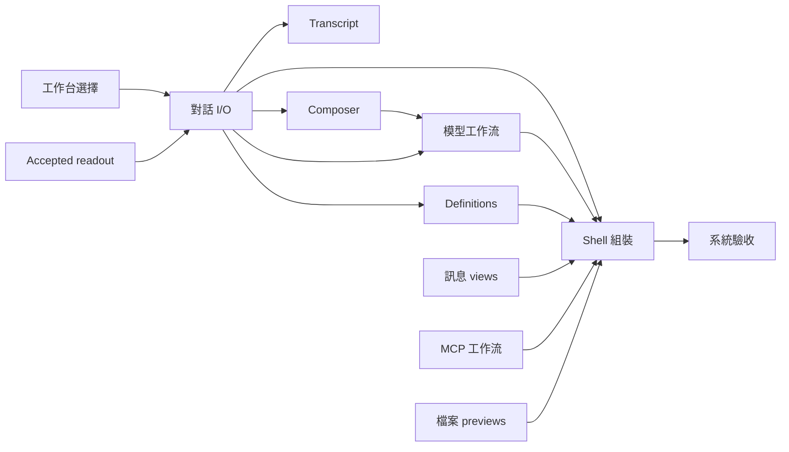

# UI 架構收斂票單計畫

Status: in-progress — 使用者已授權 workers；依下表及各票的實際證據更新進度。
Baseline: a57100bb4917d408ee51c19beeda30d3efecc857
Scope: [規格](spec.md)；保留行為及驗證歸屬見[驗收矩陣](acceptance.md)。

## Cross-effort integration

See the [combined UI + non-UI frontier](../non-ui-architecture-design/README.md#combined-ui--non-ui-implementation-frontier) for concurrent implementation, cross-ticket blockers and shared-file ownership. UI tickets remain independently owned; non-UI work may proceed concurrently when that combined graph permits.

## 執行與接手

開工先讀該票指定的 spec 節與 scenarios，確認目前 source／ticket 狀態。`Blocked by:` 列出的票全部 resolved 才可開工；進行時改為 in-progress。每票交付需包含實際呼叫端切換、已替代路徑與測試的移除、相關指南、驗證記錄及 material finding disposition。狀態只按真實完成度更新。

「可並行」僅表示依賴允許；AppShell、ChatWindow、useAgentSession、ModelsConfig 等共用檔仍須分開寫入或使用 worktree，協調者負責串接。子工作只擁有被分配的路徑，完成後報 changed paths、graph query/evidence、checks。

| 順序 | 票單 | Blocked by | Status | 主要寫入責任 |
| --- | --- | --- | --- | --- |
| 01 | [工作台選擇與草稿](issues/01-workbench-selection.md) | none | resolved／integrated | 選擇模組、AppShell 選擇 handlers、Sidebar、新對話列、draft scope |
| 02 | [Accepted conversation readout](issues/02-conversation-readout.md) | none | resolved／integrated | accepted view/prefix/metadata、useAgentSession 資料接受、相關純規則 |
| 03 | [對話 I/O 與 view attachment](issues/03-conversation-lifetime.md) | 02 | resolved／integrated 9828ff0d | useAgentSession、ChatWindow 接線、CompletionDelivery 整合、Shell 重掛移除 |
| 04 | [Transcript 與 notice 呈現](issues/04-transcript-presentation.md) | 03 | resolved／integrated b3ab7871 | ChatWindow、history navigation 接線、scroll/notice hooks |
| 05 | [Composer 互動與命令介面](issues/05-composer-interaction.md) | 03 | resolved／integrated b3ab7871 | ChatInput、draft 接線、附件／補全／原生編輯 |
| 06 | [模型與 provider 工作流](issues/06-model-workflow.md) | 03、05 | resolved — 07943df4 | ModelsConfig、catalog cache、mounted reader refresh／retry |
| 07 | [MCP 工作流](issues/07-mcp-workflow.md) | none | resolved／integrated | McpConfig、MCP helpers、sign-in/add/import/test 工作流 |
| 08 | [Definitions target 與刷新接線](issues/08-definition-refresh.md) | 03 | resolved／integrated b3ab7871 | Skills/Agents/Extensions、SettingsPanel reload、ExecutionTarget 使用者 |
| 09 | [訊息 block 呈現模組](issues/09-message-views.md) | none；04／12 驗證整合 | resolved／integrated | MessageView、其內部葉節點與既有測試；保留現有 props |
| 10 | [檔案 preview 呈現模組](issues/10-file-previews.md) | none | resolved／integrated | FileViewer、preview leaves、useDocxPreview 接線；保留 FileSeam；native save 留票 12 |
| 11 | [Shell layout 與 panel 接線](issues/11-shell-composition.md) | 01–10 | resolved／integrated `6e16e77a`；correction `cad0d86` | AppShell 最終組裝、panel/tab presentation、layout/focus 接線 |
| 12 | [系統驗收與交付記錄](issues/12-system-acceptance.md) | 11 | resolved — source `255a61ac` | 驗收證據、 owning docs、剩餘限制；僅必要整合修正 |

初始可開始：工作台選擇與草稿、Accepted conversation readout、MCP 工作流、檔案 preview 呈現模組。這是排程資訊，不是已派工或授權自動部署。

## 範圍與交付紀律

- 第一票已移轉選擇所有權；後續 Shell 票只移轉 layout/panel，不能把 domain 所有權延到最後才落實。
- readout 票已移轉資料接受及 prefix 更新；生命週期票再整合 I/O，不能讓純 fold 開 socket／timer。
- 每票刪除該票已替代的程式路徑；跨票仍待替代的有效程式繼續作唯一實作，不引入 compatibility wrapper 或永久雙路徑。
- View 拆分票使用現有功能與 adapter；不為湊拆分數新增框架。若某個葉節點實際無耦合收益，記錄具體理由，保留原實作並交由系統驗收核對規格需求是否仍滿足。
- 共享 UI 改動同步檢查 App 與 Web；開發／建置留 workstation 或 CI。部署與服務重啟不屬這份票單。
- 統一完成準則在 [spec.md](spec.md)；不以所有 tickets 變 resolved 取代未執行的驗收。
