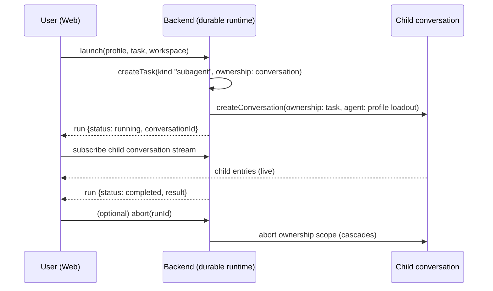

# Subagent experience — product exploration

Status: exploratory, proposals only, no implementation. Read-only source work. Ground rules from
[brief.md](brief.md) and [ADR 0001](../../docs/adr/0001-single-authoritative-durable-runtime.md) /
[ADR 0006](../../docs/adr/0006-durable-submission-lifecycle.md) /
[ADR 0007](../../docs/adr/0007-lifecycle-facts-one-projection.md): apps/server is the sole durable runtime and
SQLite writer, Web is projection, gateway owns execution-host tools and filesystem. Native facts come from installed
pi-durable 1.1.0 (`README.md`, `dist/**/*.d.ts`); companion report: [subagent-runtime.md](subagent-runtime.md).

Terminology: `.pi/agents/{worker,reviewer,scout}.md` are the **Pi coding-harness's own** workers that run this
development session. Their orchestration capability (e.g. sending a message to a child agent) is a harness feature and
does **not** imply an equivalent application capability. Nothing below treats the two as one mechanism.

## 1. Current state (confirmed in source)

| Concept | What exists | Owner | Gap |
| --- | --- | --- | --- |
| Reusable profile | `SubagentProfile` (`apps/web/lib/subagents.ts:23`): name, description, systemPrompt, tools, skills, extensions, model, thinking, maxTurns, inheritContext, runInBackground, enabled | Web | `/api/subagents/profiles` and `/api/subagents/settings` hit the adapter catch-all 501 (`adapters/durable-api.ts:798`, `code:"unsupported"`) |
| Profile UI | `AgentsConfig.tsx` renders the full editor; on 501 it sets `unavailable` and shows `t("agents.unavailable")` (:472-480); mounted at `SettingsPanel.tsx:555` | Web | **Dormant UI, not delivered functionality.** Editor, built-in switch, `maxConcurrent` 1–32 unreachable |
| Delegated run | **The app-level view and commands are missing, not the concept.** The native `Task` already owns status and lifecycle (`pending\|running\|waiting\|completing` → `completed\|failed\|aborted\|orphaned\|faulted`). No task kind is registered: `apps/server/src/harness.ts:101-102` installs only `environmentCodingTools()` + the execution-resource extension | backend | `Agent`/`get_subagent_result`/`steer_subagent` named in `subagents.ts:17`, served by nobody → the model cannot delegate. **No new parallel run registry or scheduler is implied** — what is missing is a task kind plus its projection and commands |
| Child conversation | Native and projected: `ConversationRecord.owner` (`dist/types.d.ts:263`) read as `Ancestry.subagentParent` (`server.ts:276, 1059`), published as `subagentParentConversationId` (:742, :1043); fork of a task-owned conversation refused `409 subagent` (:75-80, :1792) | backend | No creator. Both creation sites still pass `{kind:"ownerless"}` (`server.ts:1602, 1813`) |
| Run list/control | `AgentSessionPanel.tsx` + `session-family.ts` + `AppShell.tsx:248, 1678, 2251`: "agents" panel with count badge, search, row selection, shown only when the catalogue already lists a child | Web | Children never exist. Adapter fills only `parentSessionId`/`kind` (`durable-api.ts:133`); `profile`/`description`/`status` deliberately absent (`lib/types.ts:283-291`) |
| Result return | `MessageView.tsx:1184-1293` renders a `kind:"pi-web-subagent"` tool result with "open session" into `AppShell.handleOpenSession` (:1018) | Web | No producer of that shape; native `api.details({conversationId})` seam unused |
| Notification | Child completions silent by a backend fact: creator edge → `isSuppressed` (`AppShell.tsx:183-194`), `ChatWindow.tsx:294`; unread only on the family root (`SessionSidebar.tsx:1489`) | backend + Web | Delivered, meaningless until children exist |
| Isolation | Worktree list/create/remove is a gateway capability (`POST /v1/worktrees`, `packages/gateway/src/worktrees.ts`) reached as `/api/worktrees`; a checkout is a target only when recorded as a workspace; a conversation binds a **workspace**, not a directory (`docs/workbench.md:57-79`) | gateway | `StartSubagentRequest.isolation?: "worktree"` (`subagent-extension.ts:60`) has no backend equivalent |

**Unknown native support — do not assume.** The *mechanism* is native; the *feature* is entirely unbuilt. Whether
`maxTurns`, `inheritContext` and `runInBackground` are expressible natively is **unverified** — none is a
pi-durable field. No concurrency cap exists in the runtime (README exposes none).

## 2. Five things, kept apart — with native cardinality

| Object | What it is | Native carrier in 1.1.0 | Cardinality |
| --- | --- | --- | --- |
| **Profile** | static loadout: tools/resources/model for a class of work | no native object; nearest is `AgentState`/`AgentChange` via `configure()`/`createConversation({agent})` | 1 profile → N runs; profiles own nothing |
| **Worker** | a *persistent, named, addressable* child you keep assigning work to | **not native.** Nearest: a child conversation owned by a **background anchor task** (README §Abort and Subagents, example 23) | 1 worker → N runs/messages |
| **Task (run)** | one unit of delegated work | native `Task` — status and lifecycle are already its own; `owner` is its conversation or another task; `TaskGraphNode.conversations` is "Conversations this task owns, in ID order" | 1 conversation → N tasks; 1 task → N owned conversations |
| **Child conversation** | the transcript | native `Conversation`; owner is exactly one and immutable — `{kind:"ownerless"} | {kind:"task", taskId}`; `scanConversations({ownerTaskId})` is the ownership index | N conversations → 1 owner task |
| **Result** | the answer/artifacts returned to the parent | tool result content + `api.details({conversationId})` for UI attach | 1 run → 1 result |

A profile is a loadout, a worker is a durable context that outlives one assignment, a task is one assignment, a
conversation is where an assignment's transcript lives. Collapsing profile into worker hides who owns lifetime; and
"the child session is the run" turns caps, abort and cost into session-list problems. Exact cardinality is the table
above — referred from the native facts, not assumed as a product requirement. A *named* worker is a product
construct, not a native object, so cross-parent addressability must not be assumed. None of it implies a parallel run
registry or scheduler beside the native task graph.

## 3. Product axis: one-shot delegated assistant vs continue/persistent worker

| | **One-shot delegated assistant** | **Persistent named worker** |
| --- | --- | --- |
| Native shape | foreground task-owned child, created inside the tool call's task | child owned by a **background anchor task**, so the parent's Esc and idle waits never reach it |
| Lifetime | dies with the call; abort or failure cascades to the child | outlives the call; spawned, messaged (steer or follow-up), waited on, stopped, listed |
| Addressable | no — found through the call's `details` | yes, by conversation id; further work via `ConversationHandle.submit()` |
| Native precedent | README example `22-subagent-foreground.ts` | README example `23-subagent-background.ts` (background reporter tasks post answers back; `requestId` prevents double-send/duplicate report after restart) |
| Product cost | lowest: one tool + result card | needs worker registry, message/steer UX, spend visibility |
| Risk | context thrown away each time | long-lived hidden spend; who may assign work |

Both are **examples shipped with the package, not installed code** — nothing is registered in this backend. The
second is the axis the user asked about and it is native-*shaped* but unbuilt.

| | One-shot first | Worker first |
| --- | --- | --- |
| Interface to learn | 1 tool | worker list + messaging |
| Locality | task kind + tool | task kind + anchor task + routes + Web list |
| Reuse | A later worker can reuse the same child-creation seam | one-shot becomes a degenerate worker |

**One proposal, not a chosen decision:** one-shot first, on a child-creation seam a persistent worker could later
reuse; a worker would then differ only by anchor-task lifetime, not by a second mechanism. The same is true of any
human-first staging — one proposal among several, not a decision taken here.

## 4. Journeys, visibility, resources

- **Implementation.** Parent chat open. User launches a one-shot "worker" profile on a worktree checkout; parent keeps
  working. Child writes in its own checkout; its changed-file list reads through the existing workbench routes for its
  workspace. Result: summary + changed files + branch.
- **Review.** A profile restricted to read-only tools from the runtime's own registered set — `coding-tools` is
  `defineExtension({ name: 'coding-tools', tools: [createReadTool(), createWriteTool(), createEditTool(),
  createBashTool()] })` (`dist/tools/index.js`), so the registered tools are `read`, `write`, `edit`, `bash`.
  `env`, `image`, `path-utils` and `edit-diff` are module filenames or helpers, not registered tools; any further
  capability is conditional on the registry, not on the directory. The restriction is practical intent, not a
  guarantee: a shared workspace still means shared files, and no per-tool guard enforces it.
- **Research, persistent variant.** A worker is created once and given three follow-ups over an hour; each follow-up is
  a new task in the same child conversation; the worker outlives the parent's aborts because its anchor task is
  background. This is where the axis earns its cost — and where spend accumulates unseen.

Parent sees the run list, per-run status, result and abort; not the child's live tool output. Child sees its task
text, whatever context the profile inherits, and its own workspace; not the parent's later turns — context sharing is
a launch-time snapshot, not a live channel. **The child UX must respect actual ownership:** a task-owned conversation
cannot be forked (`409 subagent`), cannot be re-rooted or independently disposed, and its lifecycle is its owner
task's — abort cascades, and only a background anchor boundary stops the cascade.

- **Permissions are the profile's tool/resource selection, not a sandbox.** A read-only profile is a loadout, not an
  OS boundary; isolation belongs to the execution environment. No per-tool approval prompt proposed.
- **Workspace choice is the collision decision.** Default: child in the parent's workspace (same files — real
  collision risk; fine for review/research, not parallel edits). Opt-in: a worktree checkout, already a first-class
  workspace through `/api/worktrees`, needing no new gateway capability. Requiring a worktree for write-capable
  profiles is a product choice, not a technical one.
- **Cost/concurrency.** The runtime exposes no cap; the only artefact is the dormant `maxConcurrent` (default 10,
  `AgentsConfig.tsx:170, 492`). Natively each conversation tracks `docs["pi.usage"]` and `harness.usage(context)`
  aggregates session spend — so a spend signal is available; the Web has no surface for it. Minimal honest release:
  enforce a cap, show per-run model + tokens. Neither a cap nor cost accounting is inherited by a child as built: the
  native ownership index (`scanConversations({ownerTaskId})`) would let one owner reuse a child, but no existing
  feature does that.
- **Progress, abort, failure, recovery.** Progress = task state (`pending|running|waiting|completing` → outcome
  `completed|failed|aborted|orphaned|faulted`) plus the child's own stream. Abort = `abortTask` / ownership-scope
  abort, which natively cascades. After a restart, tasks that were running show as pending until they run again. ADR
  0006's submission lifecycle is per conversation, so a child's **snapshot and stream** reuse the existing projection
  unchanged — but submission admission is **not** automatic. A manual launch over HTTP has unknown-outcome and
  idempotency questions (the ADR's `requestId` admission exists for submissions, not for a launch route), and human
  input into a child needs its own explicit contract. Resumability of a failed run is an open question, not a design
  given.

## 5. Small conceptual interface

```ts
interface AgentProfile { name; description; instructions; tools; model?; thinking?; extensions? }
interface DelegatedRun {
  id; profile; task; workspace;
  startedBy: "user" | "model";
  status: "pending" | "running" | "waiting" | "completing" | "completed" | "failed" | "aborted" | "orphaned" | "faulted";
  conversationId;                                  // the child transcript
  result?: { summary; changedFiles?; branch? }; error?
}
launch(profile, task, { workspace, isolation? }): DelegatedRun   // one-shot
runs(parentConversationId): DelegatedRun[]
abort(runId): void
// persistent worker, later, on the same child-creation seam:
createWorker(profile, { workspace, backgroundAnchor: true }): Worker
assign(workerId, task): DelegatedRun      // submit() into the same child conversation
```

The seam is a backend run module behind `/api/subagents/*` (the routes the copied UI already calls). Web stays
projection: no run registry, scheduler or retry queue in the browser (ADR 0007).



## 6. Minimal first coherent release

1. Backend: one registered task kind creating a task-owned child conversation from a profile loadout, plus
   `POST/GET /api/subagents/runs` and `POST /api/subagents/runs/:id/abort`. One-shot only; no model tool; no worker.
2. Profiles: serve the copied `profiles`/`settings` routes so `AgentsConfig` stops being dormant. Open: do
   profiles follow the execution environment like skills (ADR 0002), or live on the backend?
3. Web: reuse `AgentSessionPanel` as the run list (it already reads the catalogue's creator edge), the existing
   result tool card, and `maxConcurrent` as a real cap.
4. Then, if the axis is wanted, add the model's `Agent` tool and the background-anchor worker over the same seam.

Verification seams: backend test for the task kind (ownership edge, abort cascade; fork refusal already covered),
adapter request/response shape test, one e2e scene asserting launch → child row → result → abort.

## 7. User questions (prioritized)

1. **Which axis first** — one-shot delegated assistant, or persistent named worker? If one-shot first, is a worker
   later a first-class goal or merely a possibility?
2. **If workers exist:** may any conversation (or the user) assign work to a named worker, or only the conversation
   that created it? And is a worker stopped when its creator ends, or does its background anchor outlive it?
3. **Focused question on reusing harness workers:** should product profiles reuse our Pi coding-harness worker
   definitions (`tools:`/`model:`/`skills:` frontmatter, resolved by `pi-subagents`), or be an independent
   profile document that merely looks similar? (Asked as a question, not assumed as a requirement.)
4. **Where do profiles live** — execution-host resources like skills (ADR 0002), or backend configuration?
5. **Workspace policy** — parent workspace by default, or worktree required for write-capable profiles? Who resolves a
   parent/child edit collision? And what default cap plus spend signal (per-run tokens, cap only, hard stop)?
6. **Result contract and child fate** — final message only, structured summary + changed files, or the child transcript
   link? Is a finished child conversation kept in the family, archived, or tombstoned? Is a failed run resumable?
