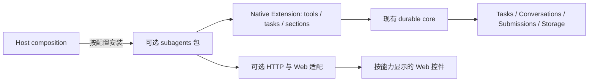

# 子代理可选扩展：Codex、pi-subagents 与当前 runtime 的研究

研究日期：2026-10-16。源码比较与早期候选，不是实现规格。最新范围以 [设计草案](conversation-api-proposal.md) 为准：工具使用名词_动词；统一 stop 并保留会话；主 stop 不级联 worker；自然完成自动回报，正常允许唤醒，用户 stop 后结果静默保存，明确继续后恢复唤醒；子会话 fork 仍为子会话；Markdown 兼容延后。下文尚未决定的产品项不覆盖这些后续决定。

后续澄清：用户明确允许通用主/子会话、跨会话引用与控制下沉核心。最新接口提案见 [通用会话与配置 API 草案](conversation-api-proposal.md)；本文的源码比较仍有效，功能归属和入口可见性以新草案为准。已有子会话与层级的可见性不依赖委派插件启用，插件能力门控仅用于配置与委派入口。用户明确要求：参考 Codex 和 `../hepi-mono/packages/pi-subagents/`，子代理必须是可选 plugin/extension。研究期间只写文档，没有修改产品、构建、部署或调用付费模型。

## 结论

建议把子代理做成独立扩展包：使用 pi-subagents 的 worker 控制与复用语义，参考 Codex 对消息投递和任务控制的区分，以现有 pi-durable 任务、会话、提交和存储承载执行。普通聊天不需要安装这个包。

这不是将现有 Pi CLI extension 原样加载进后端：它依赖不同的 ExtensionAPI、独立 Pi 进程、Unix socket、JSONL 会话和终端宿主。当前后端已有另一套完整的持久化执行框架，适配应发生在它的原生 extension 接口上。

## 三个参考对象各自证明什么

| 对象 | 已确认机制 | 对本项目的意义 |
| --- | --- | --- |
| Codex，固定提交 `922510f4d7570b42838e015787ed53abfa8761a1` | 内建多代理工具，受 feature flag 控制；存在 V1/V2 工具协议；后台执行、通知、继续派活、线程状态保留 | 参考交互与生命周期，不能据此宣称 Codex 已把子代理插件化 |
| `@hheei/pi-subagents` 0.3.0，MIT | 独立包，单一 `pi.extensions` 入口；父端提供 spawn/send/get/stop，子端提供报告桥；重复派活复用会话 | 可选包装、工具职责、配置格式和复用体验是直接参考 |
| 已安装 `pi-durable` 1.1.0 | 原生 Extension 可提供 tools/tasks/sections/hooks/wraps；任务所有权、后台边界、持久化提交、会话与恢复已存在 | 执行载体已经具备，不需要再造调度器和权威运行状态库 |

Codex 证据固定到上面提交；文档抓取日期单独记录。Pi sibling 源码为 `519d7872` 上的工作树，相关源文件和测试存在本地修改，不能将观察结果称为发布版本保证。详见三份来源报告。

## 工具语义：借鉴职责，暂不锁定全部名字

| 意图 | 参考行为 | 候选设计约束 |
| --- | --- | --- |
| 创建 worker | Pi `agent_spawn`；Codex `spawn_agent` 返回身份，后台继续 | 身份对应持久会话；创建与初始派活需要重放去重 |
| 对已有 worker 派活 | Pi `agent_send` 可继续历史会话 | 保留上下文，不为每次相关任务重新建会话 |
| 发消息但不启动工作 | Codex V2 `send_message` 的 QueueOnly | 与启动一个新任务区分；是否需要独立工具仍待定 |
| 发消息并启动工作 | Codex V2 `followup_task` 的 TriggerTurn | 明确是否唤醒空闲 worker、是否排队或转向当前工作 |
| 了解进度 | Pi `agent_get` 只查状态/进度/诊断；Codex 提供通知与限时等待 | 正常完成自动回传，检查状态不作为轮询完成的手段 |
| 中断、停止、释放与继续 | 两套实现的动词和恢复条件不同 | 分清停止当前任务与终止 worker 生命周期；保留上下文不等于任务可以原地重启 |

版本差异很重要：Codex V1 `send_input` 会启动或 steer 一个 turn，可选先 interrupt；它并不是 V2 QueueOnly 的别名。V2 才明确拆分 QueueOnly 与 TriggerTurn。候选扩展应选择一套稳定的语义，避免同时复制两代协议。

## 上下文、复用、前后台是三个独立选择

1. **创建时的上下文**：Codex V1 `fork_context` 缺省不带父历史；V2 `fork_turns` 缺省为 `all`，可选 `none`。Pi 独立子会话与 native `createConversation` 不能被自动理解成父历史 fork。复制 agent 配置也不是复制聊天历史。
2. **后续派活是否复用**：向同一子会话继续提交任务，可以保留它自己的上下文；这与第一次创建时是否携带父历史无关。
3. **前台还是后台执行**：决定父任务是否等待，以及普通停止是否传播，不决定会话历史是否保留。

因此，之前的“一次性还是持久 worker”问题需要细化。引用参考实现不代表这三个默认值已被用户选定。

## 可选扩展的责任边界

扩展包应拥有代理定义解析、委派工具、任务定义、结果回传规则和功能元数据。运行状态由 native Task 与 Submission 表达，子会话由 native Conversation 表达。为界面查询派生视图，不再维护另一套权威 worker/run 状态机。

宿主负责按配置安装扩展，以及提供必要的执行环境和 API 组合接口。pi-durable 的 Extension 没有 HTTP 路由注册接口，也没有 Pi CLI 那样的包 manifest 自动发现；这是需要明确的宿主适配点，并不意味着子代理路由必须硬编码进核心。扩展包可以另导出可选 HTTP adapter，由组合入口挂载。具体接口尚未实现。

Web 可以复用已有子会话列表、历史投影和结果卡片，但必须按扩展能力显示。无扩展时没有委派工具和委派入口，普通聊天可独立运行；已保存的历史不应因为功能未启用而消失。是否需要动态 Web 插件加载器，当前研究没有给出必要性证据。

## 原生实现路径与必须补齐的接缝

- **所有权与后台工作**：后台模式可由 conversation-owned background anchor task 持有子会话；分次派活和结果回传使用 native tasks/submissions。前台模式则可由当前 ToolTask 持有子会话并等待其结果。
- **派活和回报去重**：在事务内按 owner 查找或创建子会话，使用稳定 requestId 提交；回报使用自己的稳定提交身份。保证的是重复请求的 admission 去重，不能由此承诺任意外部模型或工具副作用恰好执行一次。
- **完成判断**：使用 native 终态与提交结果。Pi CLI 的延时收尾、提取最后一段 assistant 文本，是它为自身事件环境提供的适配，不应替代这里已有的终态事实。
- **执行主机绑定**：`apps/server/src/server.ts:955` 的环境工厂读取该会话 WorkspaceDoc，再解析 gateway/workspace。子会话继承 model/tools/cwd，不代表它自动继承应用的 WorkspaceDoc。创建接缝必须正确处理本地、SSH 与 worktree 身份。
- **递归委派**：native 示例从子会话选择中移除自身 Subagent extension，保留工具与任务分层。是否允许再次委派、并发与深度默认值，应作为扩展策略，不能直接搬用 Codex 某一版本的数值。
- **配置适配**：CLI 的扩展路径、MCP/skills 选择和工具名不能直接当作当前 registry 的名字。可复用解析与选择逻辑，但每个字段都需要明确映射或明确拒绝。既有旧设置表单的字段不等于后端已支持的契约。

## 取消选择、卸载与停止不能混为一谈

| 操作 | 已确认的 native 行为 | 产品需要表达什么 |
| --- | --- | --- |
| 会话取消选择 extension | 新工具不可用；已安装的 task definitions 仍可被解析 | 取消工具选择不会自动停止已有后台工作 |
| 从 registry 卸载 extension | 缺少定义的任务在正常调度路径 blocked，原因 `missing_task`；恢复兼容定义可重新调度 | 卸载不是成功完成，也不等于自动取消 |
| 缺少任务定义时显式 abort | scheduler 无法执行其 abort 阶段时，可落为终态 `orphaned` | 这与普通 blocked 不同；重新安装不能复活终态任务 |
| 普通 Conversation.abort | 取消普通所有权范围，不穿越后台边界 | 停止主对话不默认等于停止全部 workers |
| 显式包含后台范围的 abort | 包含后台工作 | “全部停止”必须有独立、明确的范围 |

当前调度中的 invocation 使用其已取得的快照；工具选择变更也可能让已发出的调用在执行时得到 `tool_unavailable`。不能仅凭核心 built-in tasks 不可卸载，就宣称切换扩展对正在委派的对话完全无影响。

## 复用清单

**优先评估实际代码复用**：Pi 的代理定义发现/解析、统一选择语义、纯提示组装与校验函数。适配时记录源提交、实际工作树内容、MIT 许可证与修改说明。配置格式是否保持兼容，仍要逐字段校验。

**复用行为，交给 native 实现**：稳定 worker 身份、复用上下文、自动报告、blocked/error 的区分、重复投递去重、空闲时不占用活跃执行资源。

**不纳入当前执行架构**：Pi CLI 子进程、Unix socket 协议、终端面板、JSON 注册表、JSONL 状态重建。它们在原项目有明确用途；当前 runtime 已负责相应生命周期与持久化。

README 与源码仍有差异：Pi README 的五秒 debounce、一次自动重试，没有被本次源码路径支持；观察到的是 500 ms/10 s 报告批处理与其他层的重试机制。研究将它们标为来源差异，没有将其写成候选扩展要求。

## 建议下一步与尚未决定的产品项

下一步最有价值的是验证一个**可选扩展的完整闭环**：启用 → 创建后台 worker → 父会话继续 → 自动结果回传 → 向同一 worker 再派活 → 停止当前任务 → 保留历史 → 扩展缺失与恢复。这个验证范围是建议，尚未开始实现。

仍需定：初始父历史范围、默认前后台行为、模型自行委派还是用户显式启动优先、代理定义放在哪里、stop 是否保留可继续派活的 worker。可选 extension 是已定要求，其余不能从参考项目默认值推导成用户要求。

## 来源报告与直接证据

- [Codex 研究](codex-subagents-research.md)
- [pi-subagents 源码研究](pi-subagents-research.md)
- [当前 native runtime 研究](subagent-runtime.md)
- [此前 UI 探索](subagent-experience.md)：早期候选方案，不能作为已选择的一次性/常驻或人先/模型先方案
- [Codex 工具 schema，固定提交](https://github.com/openai/codex/blob/922510f4d7570b42838e015787ed53abfa8761a1/codex-rs/core/src/tools/handlers/multi_agents_spec.rs)
- [Codex V1 输入处理](https://github.com/openai/codex/blob/922510f4d7570b42838e015787ed53abfa8761a1/codex-rs/core/src/tools/handlers/multi_agents/send_input.rs) 与 [controller](https://github.com/openai/codex/blob/922510f4d7570b42838e015787ed53abfa8761a1/codex-rs/core/src/agent/control.rs)

Native 直接来源：安装包 `apps/server/node_modules/@earendil-works/pi-durable/README.md` 的 Extensions、Per-Conversation Agent、Abort and Subagents；`dist/types.d.ts` TaskOptions；`dist/harness/scheduler.js:672` 的 blocked/run/abort 分支；应用执行绑定 `apps/server/src/server.ts:955`。安装包 README 引用的 test/examples/22、23 不在其发布文件内，本研究没有把示例链接当作已读取源码。
