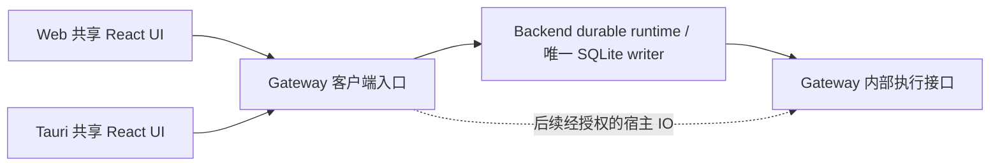

# Hepi 客户端架构适配与 Codebase Design 研究

状态：架构研究与实施建议，非实施规格。用户已确认 Tauri v2、React Router、目标入口拓扑、共享 React UI，以及复用现有协议/投影、统一资源通信适配和按测量推进优化的方向。agent loop 继续归属 Backend；私人项目无有价值历史，按新状态直接替换；不做旧用户/旧数据/旧 PWA 升级、旧版本兼容或回滚演练。最终完整删除旧 Next/BFF 和被替代路径。下文模块位置、迁移顺序、鉴权方案仍是建议，尚未实现。

基线：2026-10-17，`848f391b4245070b6677704d6a64e2a0d7356996` 加当前工作区。代码事实经源码确认，部署状态引用既有记录；未重新探测运行服务。功能创意独立留在[总览第二部分](app-architecture-and-pilo-study.md)。本轮继续研究的具体入口合同、连接作用域、认证建议与交付验收见[客户端架构蓝图](hepi-client-architecture-blueprint.md)。

> **定点记录（2026-10-17）。** 下文“当前实现”指的是当天的 Next BFF 链路。该链路已被 client-app 票 17 删除；现行拓扑、职责与入口见
> [架构](../architecture.md#ownership) 与 [客户端入口](../client-ingress.md)，当前能力与限制见[迁移状态](../migration-status.md)。本文保留为研究与来源证据，不描述现状。

## 1. 结论与明确边界

目标保持用户选定的 **App/Web ↔ Gateway ↔ Backend**。当前实现则是 **Web → Next BFF → Backend → Gateway**。两者必须分开描述，不能把当前 Backend 入口当成目标，也不能把目标写成已经实现。

目标让 Gateway 增加面向客户端的入口，App 与 Web 访问同一业务契约。**agent loop 本来就在 Backend 运行，目标中也继续在 Backend 运行**；Backend 保持 authoritative durable runtime 和唯一 SQLite writer。Gateway 继续承载进程、文件、PTY、MCP 等执行能力。Tauri 是薄客户端，不携带 Pi、Gateway sidecar 或会话数据库。

此处区分两个职责：

- **入口位置**：客户端只配置 Gateway 地址，Gateway 路由会话请求到 Backend。
- **运行时归属**：当前 agent loop、会话调度及 durable 事务在 Backend；把入口移到 Gateway 不会自动移动这些职责。[S1][S2]

本次调整的是客户端入口与 UI 复用，**agent loop 归属不是待定事项，也没有迁移到 Gateway 的计划**。工具在 Gateway 执行、durable 调度与提交由 Backend 管理，继续遵循当前一致性模型。

## 2. 当前代码适配清单

| 已有位置 | 当前职责与证据 | 适配方向 |
| --- | --- | --- |
| `apps/web/app/page.tsx` | `cookies()` 判断登录，服务端决定首屏 | 登录/首屏职责迁新入口；删除旧 Next 页面；App 由连接配置与设备登录启动 |
| `apps/web/app/api/[...path]/route.ts` | Next route、Cookie 验证、写请求 Origin 检查、Backend token | 登录和业务路由迁到 Gateway/同源入口后，删除旧 catch-all 与专用配置 |
| `apps/web/adapters/durable-api.ts` | 会话、模型、项目等兼容映射，`NextResponse`，工作区解析 | 按职责抽取已有映射；不可整包导入 WebView |
| `apps/web/adapters/{terminal,workbench,mcp-surface}.ts` | 当前经 Backend 解析工作区并代理宿主操作 | 复用授权与 workspace binding；是否缩短路径取决于测量 |
| `apps/web/components/AppShell.tsx` | UI 编排、`next/navigation`、相对 API 请求、流恢复 | 拆出少量宿主导航与连接输入后共享 |
| `apps/web/components/ChatWindow.tsx` | 聊天 UI，含 `next/image` | 替换或注入图片渲染，处理认证资源 |
| `apps/web/hooks/useAgentSession.ts` | 读取/发送/排队/模型/lease，混合多处 `fetch` 与状态 | 先集中通信 seam；保留已验证的状态逻辑 |
| `apps/web/lib/durable-projection.ts` | native snapshot → UI，纯投影 | 共享一份，服务端不重复投影 |
| `apps/web/lib/{lifecycle-projection,lifecycle-acquisition}.ts` | 发送状态、读取代次与恢复决策 | 审核依赖后共享，保留 scope/acquisition 语义 |
| `packages/session/src/{browser,agent-event-connection}.ts` | fetch SSE、cookie/bearer source、连接管理 | 沿用；增加真实 App transport 时补合同验证 |
| `packages/protocol` | 现有 wire DTO、版本、heartbeat、资源 URL | 保持跨运行时，避免 Node/Next/Tauri 依赖 |
| `packages/gateway/src/{client,host-client}.ts` | Backend → execution Gateway 的 `GatewayHostClient` | 继续服务内部调用，不作 App SDK |
| `packages/client` | `hepi-client` gateway/doctor CLI | 保持 CLI 名义；不要挪作 UI 客户端包 |
| `apps/server/src/{conversation-operations,file-relay,terminal-relay}.ts` | 会话事务与持久化、workspace 解析及执行 relay | 保留权威职责；搬入口时不重写 durable 操作 |

源码依据：[S2]–[S10]。Next 依赖少不代表迁移只需改三处 import：相对请求、动态资源、EventSource、路径别名、样式扫描和构建依赖也影响 App。

首屏通信已可按行为分组，无需先做覆盖所有端点的 SDK：

| 行为 | 当前调用点/路径示例 | Gateway 入口应隐藏的工作 |
| --- | --- | --- |
| 项目/会话目录、读取当前状态 | AppShell；`/api/sessions`、`/api/sessions/:id` | 后端地址、目录客户端映射、工作区归属 |
| 新建、发送、停止、修改队列 | useAgentSession；`/api/agent/new`、`/api/agent/:id` | 路由映射、原始 requestId、明确拒绝与未知结果区分 |
| 会话流与未知发送查询 | AppShell；`/events?after=`、`/submissions?requestId=` | 字节流转发、取消、native revision 及错误码 |
| 模型、命令、工具、lease | useAgentSession；models、`get_commands`、`get_tools` | 保留首屏与当前会话所需契约，逐项迁移 |
| 图片/长文本、文件、终端 | read-block URL、file upload、terminal adapters | URL 解析、资源认证、流式传输与 workspace 授权 |

## 3. 目标请求路径：入口和执行分开



Gateway 的客户端入口和内部执行接口可部署在同一进程，但必须有不同的路由职责、认证范围与依赖方向。图中 Backend → Gateway 是内部工具执行，不意味着客户端需要配置 Backend。[S1][S2][S8]

入口以 `/api/...` 提供当前客户端合同，调用者同步调整，无旧 URL 兼容承诺；内部 execution API 使用 `/v1/...`。Backend 的 HostClient 必须仍指向内部接口，不能再经客户端入口，避免代理递归。具体监听端口、反向代理与证书由实施时确定；当前 loopback execution listener 不等于可公开的 App 入口。

三类数据按权威归属处理：

1. **Durable 会话**：客户端 → Gateway 入口 → Backend。Backend 原生 snapshot/events 原样返回，浏览器保留唯一 UI 投影。
2. **执行任务**：Backend 选择工作区与执行宿主 → Gateway 内部 process/control 接口。Gateway 的 journal 与不确定执行结果语义继续保留。
3. **文件/终端等宿主 IO**：初期可沿用 Backend relay 保证授权和路由正确；后续让 Backend 先授权并解析 workspace，再由入口连接目标宿主传输。不能仅凭客户端提供的 cwd 就读本机文件，也不能默认入口 Gateway 就是每个项目的执行 Gateway。

API 与认证直接由 Gateway 新入口承接，不为旧 Next 建兼容代理。交付终态由 Gateway 或其同源服务入口承接浏览器登录、Cookie 与写请求 Origin 校验，并移除旧 Next/BFF；鉴权职责随迁移承接。浏览器不接触 Backend 或 execution Gateway 的内部 token。App 只持有面向用户/设备的 Gateway 访问凭证。

## 4. 前端承载方式比较

| 方案 | 复用方式 | 代价与限制 | 研究建议 |
| --- | --- | --- | --- |
| Tauri 加载远端 Web URL | 直接显示已部署 Next UI | 依赖远端页面与网络；原生权限需严格限定到可信页面，版本关系更复杂 | 可作快速体验验证，非默认交付建议 |
| 当前 Next 工程增加静态构建 | `output: 'export'`，Tauri 指向 `out` | 当前动态 API、cookies 首屏不可随静态页面打包；需要分离服务端功能，静态路由也受限 | 官方支持，但直接套现有工程不成立 |
| 共享 React UI，Web/App 两个薄入口 | Web/App 均以 Vite 构建静态 React；旧 Next 删除 | 需要抽离路由、连接配置和资源加载；两端仅保留宿主差异 | **已认可方向**，目标结构见实施规格 |

Tauri 官方明确不提供 Next 服务端运行时，Next 静态导出也不支持读取请求的动态 Route Handlers 和 cookies 等能力。[E1][E2] Vite 是官方支持的前端接入路径。[E3]

### Web 入口选择：React UI 已确定，Next 可替换

Hepi 当前核心是登录后的会话、终端与工作区交互；本轮没有要求新增 SEO 或服务端渲染能力。Web 宿主可按这些实际需求选择：

| Web 方案 | 对本项目的价值 | 取舍 |
| --- | --- | --- |
| **Vite + React + React Router** | Web/App 共用 React 客户端、路由与构建方式，适合 Gateway 提供 API 的工作台 | React Router 已选；Vite Web 宿主仍是建议，需承接登录/代理职责与页面 fallback |
| Vite + React + TanStack Router | 需要路由树、搜索参数与导航的统一类型推导/验证时适合评估 | 按 URL 状态与类型维护需求比较；不以新旧或未经测量的性能优势定输赢 |
| Next + 共享 React UI（不采用） | 需要继续维护服务端入口 | 私人项目直接替换为 Vite，不投资过渡代理 |

Vite 是开发与构建工具，React Router/TanStack Router 负责路由。此表是针对 Hepi 的设计判断，未声称其中任何一种已经迁移完成。

**建议：目标收敛为 Vite + React + React Router；实施初期可保留 Next 推进共享 UI 和 App，最终完整移除旧链路。** Next 退役不是 App 开工前置条件，但属于整体交付的必做阶段；登录职责承接、完整回归与旧实现清理必须闭环。迁到 Vite 后，两端可共用前端构建配置和资源，分别注入连接、认证及平台 adapter。

### 生态规模、现代采用与性能证据（2026-10-17）

Vite 是构建层；React Router 与 TanStack Router 是路由层；Next 是包含服务端能力的 React 框架。三者均能使用 React UI 库。选哪个路由，不会决定 Markdown、xterm、Tailwind 或普通 React 组件能否复用，也不要求绑定 TanStack Query。

本轮读取 npm 官方 API，返回统计窗口为 **2026-10-06 至 2026-10-12**：

| 包 | 窗口下载量 | 解释限制 |
| --- | --- | --- |
| `react-router` | 56,830,544 | 含直接/传递依赖、CI 与重复下载，不能当作产品数 |
| `@tanstack/react-router` | 19,881,375 | 同上；足以表明不是缺乏使用规模的方案 |
| `next` | 67,469,854 | 全栈框架包，与路由库口径不同，不据此排性能或市场占有率 |

来源：[React Router npm API](https://api.npmjs.org/downloads/point/2026-10-06:2026-10-12/react-router)、[TanStack Router npm API](https://api.npmjs.org/downloads/point/2026-10-06:2026-10-12/@tanstack/react-router)、[Next npm API](https://api.npmjs.org/downloads/point/2026-10-06:2026-10-12/next)。链接固定本轮返回窗口。下载量支持 React Router 当前安装使用规模更大的判断，不能单靠这一窗口判断增长率或新产品采用比例。

React 官方的[从零构建 React 应用指南](https://react.dev/learn/build-a-react-app-from-scratch#routing)将 React Router 与 TanStack Router 并列列为路由建议；二者均属于常用 React 方案，不应把 TanStack Router 当作仅有复杂应用才可采用的实验选项。

[上游采用证据](react-routing-adoption-evidence.md)另列固定 commit 的 manifest 与入口源码：LibreChat、AnythingLLM 使用 React Router；Chatbox、Jan 使用 TanStack Router，Jan 同时使用 Tauri 2 + Vite。样例说明两者都有实际应用，不构成“新型高性能软件采用比例”的统计，也不提供性能排名。

功能差异应按实际接入模式比较：

- **React Router**：[官方区分 Declarative、Data、Framework 三种模式](https://reactrouter.com/start/modes)。可只用轻量客户端导航；Data 模式提供 loader/action；Framework 模式已有[路由类型生成](https://reactrouter.com/explanation/type-safety)与[自动代码拆分](https://reactrouter.com/explanation/code-splitting)。因此“React Router 没类型安全/不能优化加载”不成立。
- **TanStack Router**：[官方定位](https://tanstack.com/router/latest/docs/framework/react/overview)突出路由树、导航、path/search 参数的类型推导、参数验证与 URL 状态管理；提供[自动拆分](https://tanstack.com/router/latest/docs/framework/react/guide/automatic-code-splitting)。其优势更接近减少类型与 URL 状态维护工作，不是已经证明聊天帧率更高。
- **数据层**：TanStack Router 可[协调外部数据加载/缓存](https://tanstack.com/router/latest/docs/framework/react/guide/external-data-loading)，并不强制引入 Query。Hepi 已有 durable SSE 与投影，选择路由不应生成第二份会话真相或默认给提交加自动重试。

Vite 的[官方性能说明](https://vite.dev/guide/why.html)主要涉及开发启动、HMR 与构建架构；不能据此推断正式 App 的聊天滚动或流式渲染一定比 Next 更快。本轮未做 Hepi 对比基准。

**用户已选择 React Router。** 建议先用客户端 Declarative 模式，接入已有状态层；Web 使用 BrowserRouter，App 使用 HashRouter，首期保留 `?session=`/`?cwd=`。具体 history 模式与 URL 迁移仍属于实现建议。上述 TanStack Router 比较保留作选型依据，不再作为未决事项；Web 构建细节可在实施规格确定，但旧链路完整退役已是完成条件。详细导航及连接生命周期见[蓝图](hepi-client-architecture-blueprint.md)。

建议目录（尚未创建；模块名可在实施时调整）：

```text
apps/web/                   # Vite Web composition root；旧 Next 删除
apps/app/                   # Vite composition root + src-tauri，打包静态 UI
packages/ui/                # 两个宿主实际共享的 React、hooks、投影、CSS
  src/client/               # Gateway 请求、资源加载与宿主连接配置
packages/protocol/          # 现有共享 wire contract
packages/session/           # 现有 SSE / connection / state 逻辑
packages/gateway/src/
  client-entry/             # 新入口模块，复用既有业务映射，框架无关响应
  ...                       # 既有执行接口与 HostClient
apps/server/                # 既有 durable runtime / persistence
```

`packages/ui` 只是模块安置建议，不应一次搬走整个 apps/web。先迁移 App 首屏真实依赖的切片，同步更改消费者并删除旧实现，不增加兼容 re-export。保留独立 CSS/Tailwind 扫描配置、字体/静态资产入口和 package exports；不能依赖 `@/` 永远指向 apps/web。Tauri 构建入口不能静态导入 Next、Node 或完整 coding-agent 运行时。

## 5. 深模块与真实 seam

| Module | 小 Interface | 隐藏的 Implementation | 放置建议 |
| --- | --- | --- | --- |
| Gateway 客户端入口 | 认证后的 HTTP 请求 → Response/stream | 现有路径映射、后端鉴权、workspace 路由、取消与错误映射 | Gateway composition 下的独立模块 |
| 共享 Gateway client | 会话读写、控制、流和资源的必要操作 | base URL、认证注入、拒绝/未知结果、URL 解析、stream 生命周期 | UI 内部 client 模块，先不创建独立 SDK 包 |
| Conversation stream | 沿用 `ConversationSourceFactory`/连接接口 | SSE 分块与 UTF-8、重连、scope、revision/resync | 现有 `@hepi/session` |
| 投影与发送状态 | native frame + 本地状态 → 新视图/恢复动作 | acquisition 顺序、pending/committed、未知发送查询 | 纯 TypeScript 共享模块 |
| Host integration | 导航、连接资料、生命周期、资源获取的必要输入 | Web URL/Cookie 与 App 存储/平台事件差异 | 两个薄入口按实际差异注入 |

调用者不应同时配置 API 地址、SSE 地址、附件地址和错误重试策略。一个连接配置应派生所有通道；但无需为每个 HTTP 方法包一层类，也无需平行 Rust RPC 业务协议。

`GatewayHostClient` 已有 process/control/files/terminal 四个内部 namespace，隐藏的是宿主凭证、Node 流、timeout 与 mutation uncertainty。[S8] 它与 UI client 解决不同调用者的问题，不能因为名字含 client 就导入 App。

先从 `sendAgentCommand`、会话读取和 stream source 的现有调用点收口；不要在 UI Hook 四处加入 `isTauri`。界面接口到 Web/Tauri 两个实际 adapter 时再抽象，不提前创建通用平台框架。

### 资源也是通信的一部分

现有 `toolResultImageUrl`、`thinkingUrl`、`textUrl` 返回相对 `/api/sessions/...`。[S10] Web 同源可用；Tauri 本地页面会把它解析到 App 自身 origin。必须在统一 client/resource loader 里解析到当前 Gateway，同时限定凭证仅发送给可信 Gateway。

``、下载链接和原生 `EventSource` 不能像 fetch 一样任意加 Authorization。App 的 bearer source 只解决会话 fetch SSE，不自动解决这些通道。图片可通过认证 fetch 得到 Blob URL，随视图释放；下载通过平台保存流程；终端流需支持认证 fetch SSE 或另一种经过验证的认证方案。禁止把长期 bearer token 拼到 URL。此处实施选择必须由真实平台验证收敛，不能宣称“已有 bearerSource，所以全部可直接复用”。

## 6. 认证与 Tauri 平台 seam

目前 Web 使用 `hepi-web-token` httpOnly Cookie；Next 验证后用服务端凭证访问 Backend。内部 Gateway 也有独立 bearer。[S3][S8] 这些服务器 token 都不应编译进 App。

目标认证建议：

- Web 继续 httpOnly Cookie 与写请求 Origin 校验。迁移期保留 Next 时由其代理并使用服务间身份访问 Gateway；最终由 Gateway/同源入口承担这些职责，删除旧代理实现。
- App 对 Gateway 配对或登录，领取独立、可撤销的设备凭证。凭证签发/撤销的权威归属需在认证设计中确定；首期不引入整套 RBAC。
- Gateway 校验客户端身份，使用自己的内部身份访问 Backend；日志中不得泄露 token。
- 外部入口使用 TLS。桌面配置 `localhost` 指桌面设备；手机配置同样地址指手机，不能据此猜测与 Gateway 同机。

网络 adapter 有两个实际候选：

| Adapter | 适用条件 | 必须验证 |
| --- | --- | --- |
| WebView 原生 fetch | Gateway CORS 允许真实 Tauri origin，TLS 和 CSP 正确 | Authorization preflight、SSE 不缓冲、AbortSignal、上传、各 OS WebView |
| `@tauri-apps/plugin-http` | 需要原生 HTTP 能力或规避 WebView CORS 限制 | URL permissions、stream/cancel 行为、JS/Rust 版本与移动平台实测 |

先验证原生 fetch；实际受阻再选 plugin-http。官方插件目前声明 Rust 1.90+，并要求配置 HTTP 权限；这不证明所有设备的长连接行为已经满足 Hepi。[E4] Capabilities 管控 Tauri IPC/plugin 调用，浏览器网络另外受 CORS/CSP 约束，不能互相替代。[E5][E6]

凭证存储可评估平台 keychain 或 Stronghold；Stronghold 是加密 vault，需要解锁/密钥来源设计，不能直接等同于“无交互系统钥匙串”。[E7] 首期以所选目标设备的可撤销登录和安全保存流程为验收，不提前承诺所有平台完全相同实现。

Tauri Rust 层只承担已需要的原生能力：窗口、保存文件、凭证与生命周期桥接等。通知可后置；不为了通知先引入移动推送基础设施。

## 7. 会话恢复：沿用现有协议

当前会话使用 HTTP 控制 + SSE，已经包含 native snapshot、revision、`resync_required`、heartbeat 与 submission 查询；终端有自己的 cursor/replay 规则。[S5][S6][S9][S10] 双向交互不要求统一改成 WebSocket。

恢复流程建议复用已有连接/投影模块：

1. App 回前台或网络恢复，关闭/废弃旧连接和旧 acquisition，避免旧地址或旧会话结果写入当前视图。
2. 重新读取原生 baseline snapshot；现有 browser source 不会自动发送 `after`。代理虽支持 revision 参数，仍须显式接入才可使用，不能当作 App 已有增量重放。Backend 按已有规则给 snapshot 或要求 resync；会话 revision 不是全局 cursor，事件也不保证永久可补播。
3. 对仍等待结果的发送，以原始 `requestId` 查询 submission：已提交则补齐，排队则继续等待，查无记录仍如实显示未知。
4. `resync_required`、丢失帧或无效响应由当前契约恢复或明确报错，不能从 UI 消息缺失推断请求失败。

沿用 ADR 0006：**未知结果先查，不自动重发**。backend admission 的幂等性不等于可以给所有 mutation 自动重试；HostClient 的未知执行结果同样不能盲目重跑。[S7][S8]

移动端无需维持永久后台 socket。Android 官方明确缓存进程可能无执行时间或被杀。[E8] 以“回前台可恢复”为基础；iOS 暂停/恢复仍须实机验证，本轮未完成 iOS 官方生命周期页面内容核验。通知不是会话真相来源。

## 8. 同机优化：先消除多余工作

| 优化项 | 当前事实 / 预期收益 | 优先级与实施限制 |
| --- | --- | --- |
| SSE 原字节透传 | Web durable adapter 已如此实现；无需代理层再次 parse/stringify | Gateway 新入口保持此性质、背压、取消、上游状态与响应类型 |
| 文件流式传输 | Backend file-relay 已传 request/response body；已有能力 | 保留，不能重新包装大 JSON；这是避免完整缓冲，不等于内核 zero-copy |
| 缩短宿主 IO 路径 | 目标 Gateway 入口可减少文件/终端绕行 | 授权与 workspace 解析稳定后实施；远程/SSH 项目仍可能需另一个执行宿主 |
| 批量资源读取 | `resourceSnapshot` 已是现有 HostClient capability | 先复用，避免 N 次小请求；不要把已实现能力再记成新工作 |
| UDS | 可替换同机进程间 TCP 传输 | 需明确 socket 挂载、权限、容器与 Windows fallback；HTTP over UDS 仍有 HTTP/JSON 编解码 |
| 同进程调用 | 可消除进程间协议与序列化 | 必须仍保持唯一 writer 和职责 seam；改变部署/故障隔离，待测量证明收益再研究 |

源码依据：[S3][S8][S9]。UDS 适用于 Gateway/Backend 等宿主进程，不能由 WebView 的普通 fetch 直接连 Unix socket；若为 App 增原生 bridge，复杂度也需计入。

客户端地址是 localhost 不构成调低 heartbeat 的依据：代理、转发和容器仍可能存在，当前 heartbeat 有统一协议常量。代理不能在任意字节位置自行注入心跳，以免切坏原帧。[S10]

优化前测量会话首屏、首个 stream frame、发送到 admission、文件吞吐、长会话渲染、代理内存；记录各 hop 的耗时。当前未有数据证明 loopback TCP 是主瓶颈，也未有 Hepi Tauri 安装包/内存/复用率的实测结果。

## 9. 渐进实施顺序与验收

| 阶段 | 具体交付 | 退出条件 |
| --- | --- | --- |
| A. 合同与入口 | 明确首屏 API/资源清单，框架无关 Gateway 入口承接已有映射 | App/Web 用同一业务契约；内部 token 不出宿主；无 proxy 递归 |
| B. 最小 Tauri spike | 一个桌面目标 + 一个移动目标；读目录、会话、发送、SSE、图片 | 真实设备连 Gateway；拒绝/未知结果可区分；回前台能恢复 |
| C. 共享 UI 切片 | React 聊天/会话逻辑、投影和资源 client 抽取；Web/App 薄入口 | 目标能力可用；App 产物无 Next/Node/agent runtime 依赖 |
| D. 流与生命周期验收 | Cookie/bearer、资源认证、终端、上传、切地址/会话/账号 | 旧请求被取消；断流不重复发送；多端提交顺序由 Backend 决定 |
| E. 旧 feature 完整退役 | 删除被替代实现、临时 re-export/fallback、旧专用依赖、配置、服务和测试；更新当前指南 | 新 Web/App 独立运行，旧路径不可达，退役清单逐项关闭；详见[蓝图](hepi-client-architecture-blueprint.md) |
| F. 路径与性能优化 | 测量后选择宿主 IO 直路、批量读取或 UDS | 改善有数据，durable 和 workspace 授权不退化 |

阶段是依赖关系，不是要求一次完成的改造清单；spike 不承诺正式发行、所有 OS 签名或功能储备中的产品功能。

验证放在公开 seam：Gateway 入口合同验证状态码、认证、流式取消和 workspace 路由；共享投影复用现有测试；Web/App 同场景验证发送结果恢复、snapshot/resync、历史资源与终端。App 体积和内存同时记录平台、构建模式与场景，不能拿其他项目的估值当验收值。

首个完整场景：Web 创建会话 → App 读取并发送 → 发送响应丢失 → App 回前台查询 submission → 两端各显示一次已提交内容；Gateway/Backend 重启后按原 durable 规则恢复。场景同时检验入口、共享 UI、设备认证和恢复 seam。

## 10. 待实施阶段确定的事项

- 先验证哪个桌面与移动目标，构建机与签名条件是否具备？Linux/Windows 不能替代 macOS 上的 iOS 构建与签名环境。[E9]
- Gateway 的外部 TLS 入口与身份模型，设备凭证签发、撤销与安全保存怎样落地？
- 入口是否允许经授权后直连其他 execution Gateway？第一阶段可沿用 Backend relay。
- 所选设备的原生 fetch 能否满足 SSE、上传与取消？需不需要 plugin-http？

Web 目标建议 Vite，具体构建细节仍待实施规格确定；旧 Next/BFF 完整退役已列为必做验收。Backend 运行 agent loop、共享 React UI 与 React Router 已确定。上述问题不影响当前研究结论；实施规格应在选定阶段解决相应事项。没有明确离线写入需求，就不创建 App SQLite 副本、离线发送队列或 CRDT。

## 11. 一手来源与可追溯证据

源码链接指向本轮工作区事实，不代表目标设计已交付。外部官方资料于 2026-10-17 核验；动态文档后续实施仍需与锁定版本对照。

### Hepi 源码与已有决定

- [S1] [Architecture](../architecture.md)、[单一 authoritative runtime ADR](../adr/0001-single-authoritative-durable-runtime.md)、[同机部署记录](../backend-local-migration-2026-10-16.md)。
- [S2] [Backend server](../../apps/server/src/server.ts)、[ConversationOperations](../../apps/server/src/conversation-operations.ts)、[Gateway server](../../packages/gateway/src/index.ts)。
- [S3] 历史源码事实：Next catch-all route、durable API adapter、Next 首页与 `apps/web/next.config.ts` 已由[票 17](../../.scratch/client-app/issues/17-retire-next-and-transition-paths.md)删除；本行记录 2026-10-17 的源码状态，不指向现存文件。
- [S4] [AppShell](../../packages/ui/src/components/AppShell.tsx)、[useAgentSession](../../packages/ui/src/hooks/useAgentSession.ts)、[conversation API](../../packages/ui/src/lib/conversation-api.ts)、[ChatWindow](../../packages/ui/src/components/ChatWindow.tsx)。
- [S5] [Browser session transport](../../packages/session/src/browser.ts)、[AgentEventConnection](../../packages/session/src/agent-event-connection.ts)。
- [S6] [Durable projection](../../packages/ui/src/lib/durable-projection.ts)、[lifecycle projection](../../packages/ui/src/lib/lifecycle-projection.ts)、[lifecycle acquisition](../../packages/ui/src/lib/lifecycle-acquisition.ts)。
- [S7] [Submission lifecycle ADR](../adr/0006-durable-submission-lifecycle.md)、[one projection ADR](../adr/0007-lifecycle-facts-one-projection.md)。
- [S8] [GatewayHostClient](../../packages/gateway/src/client.ts)、[Host transport](../../packages/gateway/src/host-client.ts)、[Backend-to-gateway guide](../local-integration.md)。
- [S9] [File relay](../../apps/server/src/file-relay.ts)、[terminal relay](../../apps/server/src/terminal-relay.ts)；Web terminal adapter 已随票 17 删除。
- [S10] [Protocol：heartbeat 与 read-block URL](../../packages/protocol/src/index.ts)、[Gateway contract](../../packages/protocol/src/gateway.ts)。

### 官方平台资料

- [E1] [Tauri v2：Next.js 集成](https://v2.tauri.app/start/frontend/nextjs/)。
- [E2] [Next.js：Static Exports 与 unsupported features](https://nextjs.org/docs/app/guides/static-exports)。
- [E3] [Tauri v2：Vite 集成](https://v2.tauri.app/start/frontend/vite/)。
- [E4] [Tauri HTTP plugin：版本、权限与 JS fetch](https://v2.tauri.app/plugin/http-client/)。
- [E5] [Tauri Capabilities](https://v2.tauri.app/security/capabilities/)。
- [E6] [Tauri CSP](https://v2.tauri.app/security/csp/)。
- [E7] [Tauri Stronghold](https://v2.tauri.app/plugin/stronghold/)。
- [E8] [Android：Processes and app lifecycle](https://developer.android.com/guide/components/activities/process-lifecycle)。
- [E9] [Tauri Prerequisites：iOS 等目标平台工具链](https://v2.tauri.app/start/prerequisites/)。
